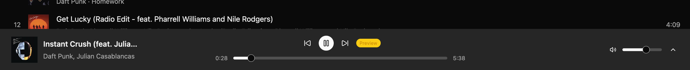
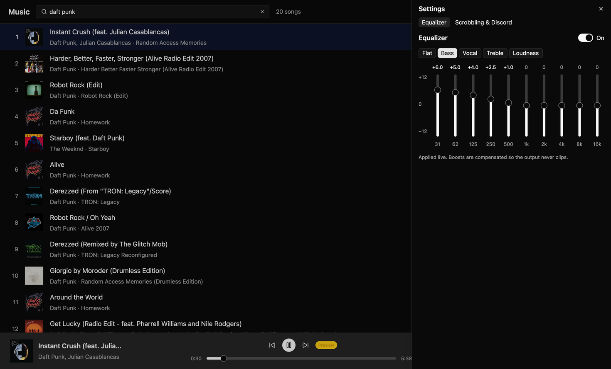
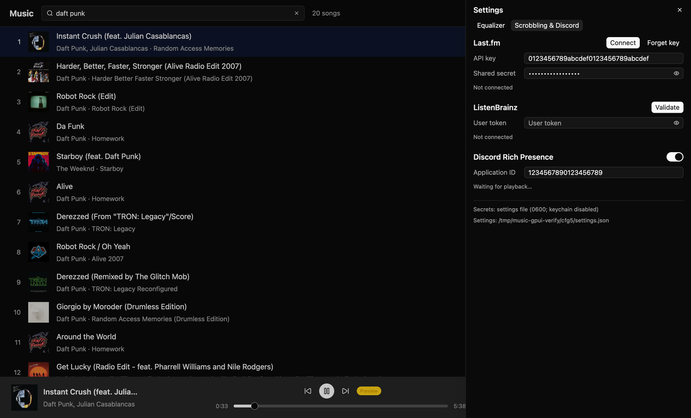
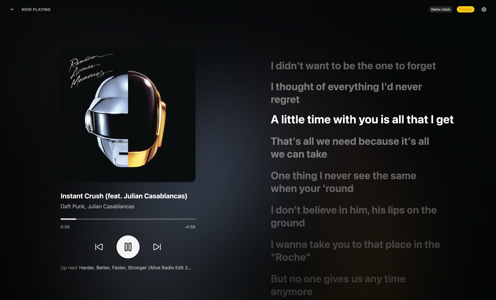
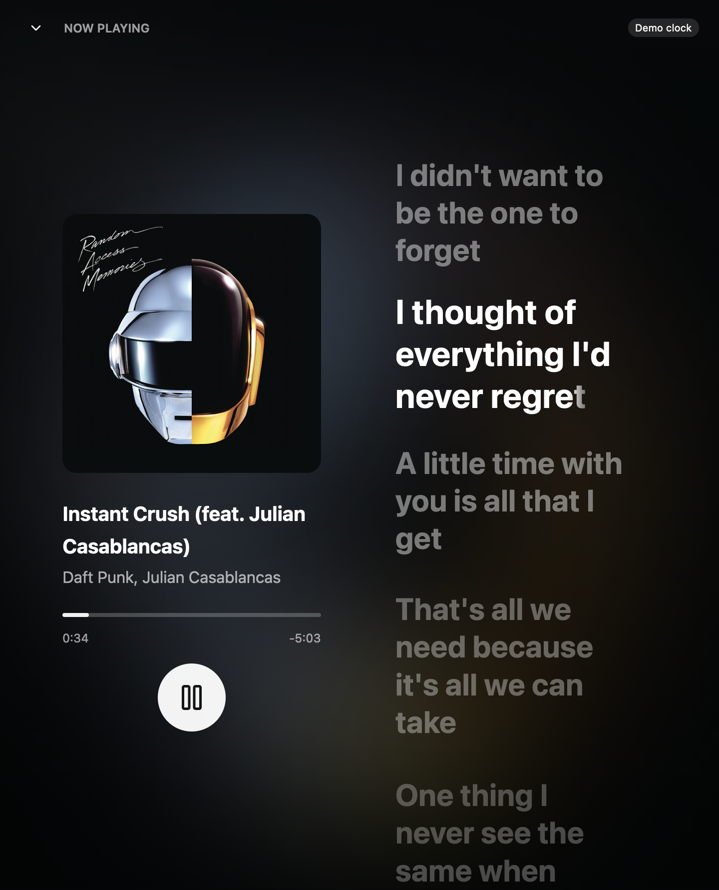

# music-macos — native desktop YouTube Music client

A lightweight Rust desktop client (macOS, Windows, Linux) in the spirit of the
Android app ArchiveTune: a UI-agnostic core (`crates/music-core`) and a GPUI
app (`crates/music-gpui`, see [music-gpui](#music-gpui-gpui--gpui-component)).

**License:** GPL-3.0 (see `LICENSE`), because features are ported from
ArchiveTune (GPL-3.0, © Rukamori and contributors). Code ported from
Hummingbird is Apache-2.0 and listed in `crates/music-core/THIRD_PARTY.md`.
This is an independent project: it is not ArchiveTune and uses none of its
name or branding.

## Decision: GPUI + gpui-component

The UI framework was picked by building the same spikes in three stacks. `main`
now carries the winner; the other branches are kept for reference.

| Branch | UI stack | Outcome |
|---|---|---|
| `main` (= `ui/gpui-component`) | GPUI (`gpui-pre` 0.3.10) + gpui-component 0.8.1 | **Chosen** |
| `ui/slint` | Slint 1.18 (FemtoVG) | Built everything incl. karaoke lyrics, but word layout relies on Slint's internal text engine (Parley) and the accessibility tree is rebuilt every animated frame |
| `ui/hummingbird` | Fork of Hummingbird (GPUI, `gpui-unofficial`) | Works by converting YouTube tracks to tagged local files; 38.5 MB binary, fork upkeep. Used as a donor instead (EQ, media controls, scrobbling ported into music-core) |

Deciding test — Now Playing with word-by-word karaoke lyrics (release, macOS arm64, 60 Hz):

| | Slint | GPUI |
|---|---|---|
| CPU while lyrics animate | 79 % avg (19 % with accessibility compiled out) | 17 % avg |
| Frame rate | 53–61 fps (steady 60 without accessibility) | ~61 fps, worst gap 17.8 ms |
| RSS while animating | ~139 MB | ~104 MB |
| Idle, screen closed | 0 % | ~0 % |
| Binary | 17.7 MB | 21.8 MB |

Accepted risks of GPUI: a pinned pre-release snapshot (Zed deprioritises
non-Zed users), thin accessibility, no transforms/blur/masks on arbitrary
elements (worked around with custom painting and `anim.rs`). The core stays
UI-agnostic so the UI could be swapped again.

## Shared core (`crates/music-core`)

Blocking, thread-safe, no async runtime, so every UI toolkit can drive it from
its own executor.

* `InnerTube` — YouTube Music (`WEB_REMIX`) metadata: home (+ mood chips, continuation),
  explore, charts (per country), moods & genres, new releases, album / artist / playlist
  pages, search (summary, per-category filters, suggestions, continuations), play queues
  (`next`, `RDAMVM<id>` radio), related and lyrics tabs; locale via `hl`/`gl`. A cookie-based
  account layer (`innertube::Auth`, SAPISIDHASH) adds account info, library, history, likes,
  subscriptions and playlist editing (request bodies unit-tested; not yet verified live).
  Ported from ArchiveTune, see `THIRD_PARTY.md`.
* `http::configure(HttpConfig { proxy, user_agent, timeout })` — process-wide HTTP agent
  (http/https/socks4/socks5 proxies; no DNS-over-HTTPS).
* `StreamResolver` trait + `IosClientResolver` — video id → audio URL (AAC itag 140).
* `Player` — audio thread with a pollable `PlaybackState`, loudness normalization
  from YouTube's per-format `loudnessDb`, `pause`/`resume`/`toggle_pause`/`seek`.
  Decoding is Symphonia 0.6 (`TrackDecoder`, a seekable `rodio::Source`), so seeking
  works inside truncated previews too; rodio/cpal only mix and output.
* `equalizer` — parametric EQ (port of Hummingbird's), applied live:
  `player.set_equalizer(EqPreset::Bass.settings())`, `player.clear_equalizer()`.
* `media_controls` — macOS Now Playing / media keys, Windows SMTC, Linux MPRIS
  (feature `media-controls`, default on).
* `scrobble` — Last.fm + ListenBrainz (`ScrobbleTracker` applies Last.fm's rules to
  `PlaybackState` snapshots; `Scrobbler` sends on a worker thread).
* `discord` — Discord Rich Presence (feature `discord`, default on).
* `fetch_lyrics` — LRCLIB synced lyrics.
* `library` — SQLite library (`rusqlite`, bundled): likes, library, artists/albums, playlists
  (local + YouTube mirrors), play history, listening stats and "year in music", search
  history, lyrics cache, saved queue, zip backup/restore. `Library` is `Clone + Send + Sync`.
* `downloads` — `DownloadManager`: user downloads (never evicted) and an LRU play cache, two
  workers on the `StreamResolver`, pollable `states()`.
* `local_files` — scans music folders with `lofty` (tags, cover art, lyrics, ReplayGain) into
  the library as `local:<hash>` tracks, incrementally.

```sh
cargo run --release -p music-core --example library -- ~/Music   # scan a folder, print stats
```

Media controls, scrobbling and Discord all hang off the poll the UI already does:

```rust
// once, on the UI thread after the event loop/main window exists
// (macOS: main thread; Windows: set `config.hwnd` to the main window's HWND)
let mut controls = MediaControls::for_player(
    MediaControlsConfig::new("music_macos", "Music"),
    player.clone(),
    |event| { /* MediaControlEvent::Next / Previous → UI queue */ },
)?;
let mut scrobbler = Scrobbler::new(vec![
    Box::new(LastFm::new(api_key, api_secret).with_session(session_key)),
    Box::new(ListenBrainz::new(user_token)),
]);
let mut discord = DiscordPresence::new(DiscordConfig::new(discord_app_id));

// every ~250 ms tick
let state = player.state();
controls.update(&state);   // only talks to the OS when something changed
scrobbler.update(&state);  // never blocks; requests run on a worker thread
discord.update(&state);
```

Credentials are always supplied at runtime; `examples/scrobble.rs` runs the Last.fm
auth flow (`get_token` → `auth_url` → `get_session`). Threading details are in the
`media_controls` module docs. Ported code is listed in
[`crates/music-core/THIRD_PARTY.md`](crates/music-core/THIRD_PARTY.md) (Apache-2.0).

```sh
cargo run --release -p music-core --example resolve -- "daft punk"  # headless: search → resolve → download → seek to 30 s → decode
cargo run --release -p music-core --example cli -- "daft punk"      # plays ~8 s through the speakers (seeks, Bass EQ)
cargo run --release -p music-core --example browse -- "daft punk"   # every anonymous InnerTube endpoint, live
```

### Known limitation: previews only (PoToken)

Without a PoToken, googlevideo serves only the first 1 MiB of a stream and
answers 403 afterwards, so every spike plays roughly the first minute of a
track (`PlaybackState::preview_only` is set). Full playback needs a PoToken
provider behind `StreamResolver` — ArchiveTune does this with YouTube's
BotGuard challenge in a hidden WebView. That decision is deliberately left open.

## Spike spec (identical in every UI branch)

1. Window ~1100×720, dark theme.
2. Search field → `InnerTube::search_songs` on a background thread.
3. Virtualized results list: artwork (`Track::artwork_url(120)`), title,
   artists · album, duration. Click a row to play it.
4. Now-playing bar: artwork, title/artists, play/pause, progress bar with
   elapsed/total time and click-to-seek, "preview" badge when `preview_only`.
5. UI polls `Player::state()` every ~250 ms; no other cross-thread plumbing.

## How to compare

Build each branch with `cargo build --release` and record:

* Release binary size (and bundled app size where applicable).
* Idle RSS after launch, RSS with 20 results and artwork loaded, RSS while playing
  (`ps -o rss= -p <pid>` or Activity Monitor "Memory").
* CPU while playing with the window visible vs. hidden.
* Cold start to first frame, clean build time, scroll smoothness.

## music-gpui (GPUI + gpui-component)

The GPUI client (`crates/music-gpui`), picked over Slint after the benchmark rounds below.

```sh
cargo run --release -p music-gpui
# no audio device / sandbox: fake playback from 20 s that "ends" at 80 s like a preview
MUSIC_DEMO_CLOCK=1 cargo run --release -p music-gpui
# dev-only offscreen screenshots (GPUI test-support; separate, slower build)
MUSIC_QUERY="daft punk" MUSIC_GPUI_SCREENSHOT="9:/tmp/bar.png,9.5:@settings=eq,11:/tmp/eq.png" \
  cargo run --release -p music-gpui --features screenshot
```

|  |
|---|

|  |  |
|---|---|
|  |  |

### Features

* **Search** (debounced, `InnerTube` on the background executor), virtualized results with artwork.
* **Queue** (`queue.rs`): clicking a result plays it with the result list as the queue. Next /
  previous in the bar, on the Now Playing screen and from media keys; "previous" restarts the
  track past 3 s; when the current track ends (`PlaybackStatus::Ended`, which is also what a
  ~60 s preview does) the next one starts. "Up next" on the Now Playing screen.
* **Now Playing** (`now_playing.rs`, `karaoke.rs`, …): blurred-artwork backdrop, springy
  artwork, LRCLIB lyrics with a partial-word karaoke sweep and staggered scrolling (details in
  the history below).
* **OS media controls** (`services.rs`): `MediaControls::for_player` is created once, on the
  main thread, when the engine is ready (the window exists by then). Play/pause/seek/volume go
  straight to the `Player`; next/previous come back to the UI through a channel drained on the
  250 ms poll. The 544 px artwork bytes are handed over once downloaded. Windows passes the
  main window's HWND (GPUI's `Window` implements `raw-window-handle`) — compiled only on macOS
  so far. With the demo clock, `MediaControls::new` routes every event through the UI.
* **Equalizer** (settings sheet): on/off, `EqPreset::ALL` buttons, ten vertical ±12 dB sliders
  for `GRAPHIC_BANDS_HZ`, applied live (`Player::set_equalizer` / `clear_equalizer`).
* **Scrobbling & Discord** (settings sheet): Last.fm API key + shared secret → *Connect*
  (`get_token`, opens `auth_url` in the browser) → *Finish* (`get_session`) → "Connected as …" /
  *Disconnect*; ListenBrainz token + *Validate*; Discord Rich Presence switch + application id
  with connection status; the last scrobble errors (`Scrobbler::take_errors`). Network calls run
  on worker threads; `Scrobbler` and `DiscordPresence` are fed from the poll and are only fed
  with real audio (demo-clock plays are never scrobbled).
* **Volume** slider + mute button in the bar (`Player::set_volume`, saved).

### Settings file and secrets

`settings.json` (volume, EQ, Last.fm API key + user name, ListenBrainz user name, Discord
switch + id) lives in the platform config dir — macOS
`~/Library/Application Support/music-macos/`, Linux `~/.config/music-macos/`, Windows
`%APPDATA%\music-macos\config\` — or `$MUSIC_CONFIG_DIR`. It is written 500 ms after the last
change and on quit, atomically (temp file + rename), mode 0600 in a 0700 directory. Missing
fields fall back to defaults, unknown ones are ignored, out-of-range values are clamped, and a
file that isn't valid JSON is moved to `settings.json.bad`.

The Last.fm shared secret and session key and the ListenBrainz token go to the OS keychain
(`keyring` 4: macOS Keychain, Windows Credential Manager, Secret Service), service
`music-macos`, one entry each. If the keychain fails (or `MUSIC_SECRET_STORE=file`), they are
stored in the `secrets` object of `settings.json` (still 0600) and moved back into the keychain
the next time it accepts a write; the settings sheet shows where secrets are kept. The keychain
is only read for accounts the settings say exist, on a worker thread (macOS may show an
"allow access" prompt — for unsigned dev builds it does so after every rebuild, because the
item's ACL is tied to the binary). Secrets are never logged.

### Environment hooks

| Variable | Effect |
|---|---|
| `MUSIC_QUERY=…` | pre-fill and run a search (`MUSIC_GPUI_QUERY` still works) |
| `MUSIC_AUTOOPEN=1` | play the first hit and open Now Playing (`MUSIC_GPUI_AUTOPLAY=1`: play only) |
| `MUSIC_DEMO_CLOCK=1` | demo clock instead of audio (also used automatically when `Player::new` fails) |
| `MUSIC_VOLUME=0.0` | volume for this session, not saved (muted real-device tests) |
| `MUSIC_EQ_PRESET=Bass` | apply an EQ preset at startup (saved like a click) |
| `MUSIC_OPEN_SETTINGS=1\|eq\|accounts` | open the settings sheet at startup |
| `MUSIC_CONFIG_DIR=…` / `MUSIC_SECRET_STORE=file` | other settings dir / skip the keychain |
| `MUSIC_TRACE=1` | log playback transitions, seeks, saves; `MUSIC_TIMINGS=1`: renders/s + worst frame gap |
| `MUSIC_SCRIPT="5:@next,9:@seek=75,30:@quit"` | timed actions (any build) |
| `MUSIC_GPUI_SCREENSHOT="12:a.png,13:@settings,14:b.png"` | offscreen shots + actions, quits after the last (feature `screenshot`) |

Actions: `@play=N @next @prev @seek=S @toggle @open @close @volume=V @settings[=eq|accounts]
@close-settings @eq=Preset|on|off @field=lastfm-key|lastfm-secret|lb-token|discord-id:VALUE
@lastfm-connect @lastfm-finish @lastfm-disconnect @lastfm-clear @lb-validate @lb-disconnect
@discord=on|off @quit` (see `script.rs`).

### Measurements (this round)

macOS arm64, 60 Hz, release (thin LTO), `ps -o %cpu=,rss=` once a second for 20 s after an 8 s
warm-up, `MUSIC_QUERY="daft punk instant crush"`:

| Scenario | CPU % min / avg / max | RSS MiB min / avg / max |
|---|---|---|
| Now Playing animating, demo clock (`MUSIC_AUTOOPEN=1 MUSIC_DEMO_CLOCK=1`) | 11.2 / 17.7 / 23.1 | 110.9 / 112.4 / 113.4 |
| same, second run | 11.1 / 19.0 / 23.2 | 110.5 / 111.4 / 112.2 |
| Now Playing animating, **real audio, muted** (`MUSIC_VOLUME=0.0`) | 14.6 / 19.8 / 22.9 | 115.4 / 115.5 / 115.5 |
| Browse UI, real audio playing (muted), bar updating | 0.7 / 2.0 / 3.4 | 111.2 |
| Idle, nothing playing, window focused (caret blinking) | 0.2 / 0.7 / 1.5 | 87.5 / 87.6 / 87.6 |

61–62 renders/s with a worst frame gap of 17.7 ms while animating — unchanged from the lyrics
round (17.3 % / 16.8 % CPU then). RSS while playing is ~6–10 MiB higher than that round's
~102–106 MiB (media controls with artwork, scrobble/Discord/settings code); idle is lower
(88 vs 99 MiB). Release binary 23,661,248 B (22.6 MiB, +0.8 MiB). Incremental release rebuild
after touching the crate: 32–42 s here. The dependency graph grew by 17 crates (keyring + its
stores, `directories`).

**Real-device check** (`Player::new` works on this machine; always `MUSIC_VOLUME=0.0`, nothing
audible): position advances, seek 0→30 s and back works, rapid EQ changes (Bass → Treble → off
→ Loudness) during playback cause no errors, "previous" at 5 s restarts, and when a ~60 s
preview reaches its end (`Ended` at 59.9 s) the next result loads and plays. Seeking *past* a
preview's downloaded data snaps back to ~0 s (music-core decoder behaviour; not handled in the UI).

**Not verified:** real mouse/keyboard input (all interaction went through the script actions,
which call the same handlers as the buttons), OS media keys / Control Center (code path compiles
and registers; no key events could be injected), a complete Last.fm auth or actual scrobbles /
ListenBrainz listens (only the error paths with bogus credentials hit the real APIs), Discord
Rich Presence against a running Discord, Linux and Windows (including the HWND and keychain
backends).

### History: benchmark rounds (condensed)

**Round 1 — search spike.** Search, virtual list, artwork, bar with progress slider, built from
gpui-component almost without custom drawing (one ~800-line file, two trivial compile errors).
Crates: `gpui-component =0.8.1`, `gpui-kit-assets =0.8.1` and the GPUI snapshot it pins,
`gpui-pre =0.3.10` + `gpui-pre-platform =0.3.10` (aliased `gpui` / `gpui_platform`; features
`font-kit` — needed for glyphs on macOS —, `runtime_shaders` — no full Xcode —, `wayland`,
`x11`). Measured: 20.9 MiB binary, ≈10–11 min clean build (427 crates), idle RSS ≈88 MiB,
≈102 MiB with 20 results, 0.3–1 % CPU idle. Hard: confusing crate topology (the platform crate
and `runtime_shaders` only show up in `gpui-base`'s manifest), no examples in the tarballs,
build cost, `Slider` exposes no dragging state, `render_to_image` needs `test-support`.

**Round 2 — Now Playing & lyrics.** Slide-up screen with blurred backdrop (CPU blur, 4.5–14 ms
per track, cross-fade), artwork scaled with GPUI's `with_spring`, play/pause icon morph via
`svg().with_transformation`, LRCLIB lyrics as a custom `KaraokeLine` element (`shape_text` +
`paint_glyph` + `with_content_mask`: partial-word sweep with a 10-slice soft edge that survives
wrapping, sung words lift, inactive lines painted at 0.9 scale), Apple-Music-style staggered
scrolling from `ScrollHandle` child bounds, `SmoothClock` extrapolating the 250 ms polls, frames
requested only while something moves, `inactive_frame_interval: None` to avoid GPUI's 30 fps
throttle for unfocused windows. Measured 17.3 / 16.8 % avg CPU at 61.6 renders/s (worst gap
17.8 ms), ~102–106 MiB, 0–1 % idle. Learned: blocking work on GPUI's background executor
starves (artwork downloads delayed LRCLIB by >15 s → dedicated threads); value tweens readable
from state need a helper (`anim.rs`). Missing for an ArchiveTune-grade port: transforms on any
subtree, layer opacity, blur/backdrop filters, alpha/gradient masks, gradient text, shared
element transitions, a pausable animation clock, a documented non-blocking HTTP/image pipeline.
Screenshots: [karaoke sweep](docs/screenshots/gpui-karaoke-sweep-zoom.png),
[backdrop](docs/screenshots/gpui-now-playing-backdrop.png),
[open transition](docs/screenshots/gpui-now-playing-transition.png),
[pause/close](docs/screenshots/gpui-now-playing-pause-close.png).

**Round 3 — this one** (queue, media controls, EQ, scrobbling, Discord, persistence, volume).
Easy: `Sheet`, `Switch`, vertical `Slider`, masked `Input` with a reveal toggle and `Button`
selected states covered the settings UI; `Window` implements `raw-window-handle`; extra Lucide
icons can be embedded one by one with `icon_assets!`. Gotchas: `InputState::set_value` doesn't
emit `InputEvent::Change` (programmatic edits must be synced by hand), a vertical `Slider` must be
sized itself (`.h_full()` inside a sized box), not just its parent, and gpui-component's sheet leaves a title-bar gap
unless `Theme::sheet.margin_top` is zeroed. No changes to `music-core`.
