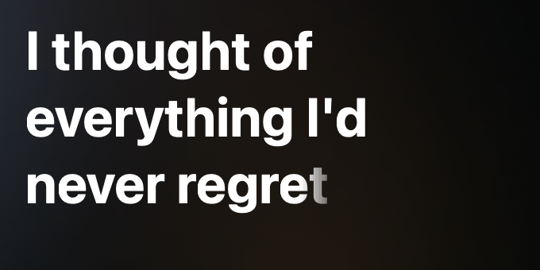
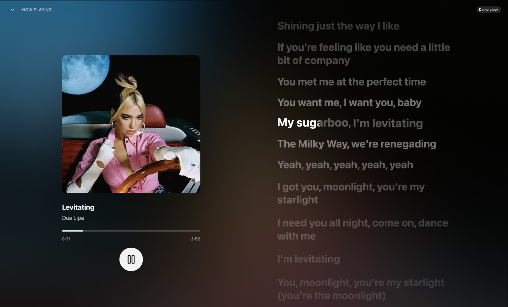
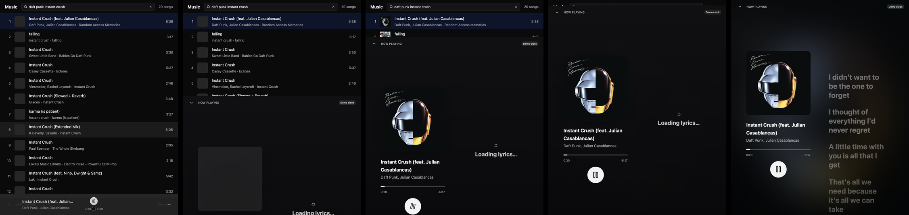
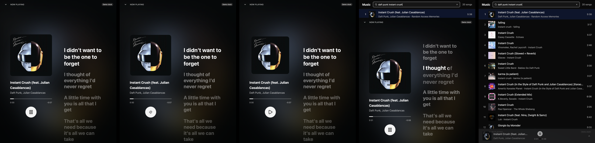

# music-macos — desktop YouTube Music client spikes

Three UI spikes on top of one shared Rust core, to pick a UI framework by
measurement instead of by opinion. All three target macOS, Windows and Linux.

| Branch | UI stack | Idea |
|---|---|---|
| `main` | — | Shared core only (`crates/music-core`) |
| `ui/slint` | Slint 1.x | Stable, declarative, accessible |
| `ui/gpui-component` | GPUI (`gpui-pre`) + gpui-component | Zed's GPU UI + 60-widget kit |
| `ui/hummingbird` | Hummingbird (GPUI, `gpui-unofficial`) | Fork an existing native GPUI music player and add YouTube Music to it |

## Shared core (`crates/music-core`)

Blocking, thread-safe, no async runtime, so every UI toolkit can drive it from
its own executor.

* `InnerTube` — anonymous YouTube Music (`WEB_REMIX`) song search.
* `StreamResolver` trait + `IosClientResolver` — video id → audio URL (AAC itag 140).
* `Player` — audio thread with a pollable `PlaybackState`, loudness normalization
  from YouTube's per-format `loudnessDb`, `pause`/`resume`/`toggle_pause`/`seek`.
  Decoding is Symphonia 0.6 (`TrackDecoder`, a seekable `rodio::Source`), so seeking
  works inside truncated previews too; rodio/cpal only mix and output.
* `equalizer` — parametric EQ (port of Hummingbird's), applied live:
  `player.set_equalizer(EqPreset::Bass.settings())`, `player.clear_equalizer()`.
* `media_controls` — macOS Now Playing / media keys, Windows SMTC, Linux MPRIS
  (feature `media-controls`, default on).
* `scrobble` — Last.fm + ListenBrainz (`ScrobbleTracker` applies Last.fm's rules to
  `PlaybackState` snapshots; `Scrobbler` sends on a worker thread).
* `discord` — Discord Rich Presence (feature `discord`, default on).
* `fetch_lyrics` — LRCLIB synced lyrics.

Media controls, scrobbling and Discord all hang off the poll the UI already does:

```rust
// once, on the UI thread after the event loop/main window exists
// (macOS: main thread; Windows: set `config.hwnd` to the main window's HWND)
let mut controls = MediaControls::for_player(
    MediaControlsConfig::new("music_macos", "Music"),
    player.clone(),
    |event| { /* MediaControlEvent::Next / Previous → UI queue */ },
)?;
let mut scrobbler = Scrobbler::new(vec![
    Box::new(LastFm::new(api_key, api_secret).with_session(session_key)),
    Box::new(ListenBrainz::new(user_token)),
]);
let mut discord = DiscordPresence::new(DiscordConfig::new(discord_app_id));

// every ~250 ms tick
let state = player.state();
controls.update(&state);   // only talks to the OS when something changed
scrobbler.update(&state);  // never blocks; requests run on a worker thread
discord.update(&state);
```

Credentials are always supplied at runtime; `examples/scrobble.rs` runs the Last.fm
auth flow (`get_token` → `auth_url` → `get_session`). Threading details are in the
`media_controls` module docs. Ported code is listed in
[`crates/music-core/THIRD_PARTY.md`](crates/music-core/THIRD_PARTY.md) (Apache-2.0).

```sh
cargo run --release -p music-core --example resolve -- "daft punk"  # headless: search → resolve → download → seek to 30 s → decode
cargo run --release -p music-core --example cli -- "daft punk"      # plays ~8 s through the speakers (seeks, Bass EQ)
```

### Known limitation: previews only (PoToken)

Without a PoToken, googlevideo serves only the first 1 MiB of a stream and
answers 403 afterwards, so every spike plays roughly the first minute of a
track (`PlaybackState::preview_only` is set). Full playback needs a PoToken
provider behind `StreamResolver` — ArchiveTune does this with YouTube's
BotGuard challenge in a hidden WebView. That decision is deliberately left open.

## Spike spec (identical in every UI branch)

1. Window ~1100×720, dark theme.
2. Search field → `InnerTube::search_songs` on a background thread.
3. Virtualized results list: artwork (`Track::artwork_url(120)`), title,
   artists · album, duration. Click a row to play it.
4. Now-playing bar: artwork, title/artists, play/pause, progress bar with
   elapsed/total time and click-to-seek, "preview" badge when `preview_only`.
5. UI polls `Player::state()` every ~250 ms; no other cross-thread plumbing.

## How to compare

Build each branch with `cargo build --release` and record:

* Release binary size (and bundled app size where applicable).
* Idle RSS after launch, RSS with 20 results and artwork loaded, RSS while playing
  (`ps -o rss= -p <pid>` or Activity Monitor "Memory").
* CPU while playing with the window visible vs. hidden.
* Cold start to first frame, clean build time, scroll smoothness.

## GPUI + gpui-component spike notes

```sh
cargo run --release -p music-gpui
# measurement helpers: pre-fill + run a search, play the first hit and open Now Playing
# (MUSIC_DEMO_CLOCK=1 fakes playback from 20 s when there is no audio device)
MUSIC_QUERY="daft punk instant crush" MUSIC_AUTOOPEN=1 MUSIC_DEMO_CLOCK=1 cargo run --release -p music-gpui
# (round-1 names MUSIC_GPUI_QUERY / MUSIC_GPUI_AUTOPLAY still work)
# dev-only offscreen screenshots (enables GPUI test-support; separate, slower build)
MUSIC_QUERY="daft punk" MUSIC_GPUI_SCREENSHOT=/tmp/shot.png \
  cargo run --release -p music-gpui --features screenshot
# several shots / scripted actions, in seconds since launch
MUSIC_GPUI_SCREENSHOT="13:/tmp/a.png,14:@toggle,14.1:/tmp/b.png,16:@close,16.1:/tmp/c.png" ...
```

**Dependencies.** `gpui-component =0.8.1` (GPUI Kit's styled layer, on `gpui-base 0.8.1`),
`gpui-kit-assets =0.8.1` (Lucide icons; only the 101 default icons are embedded), and the
exact GPUI snapshot gpui-component pins: **`gpui-pre =0.3.10`** (aliased as `gpui`) plus
**`gpui-pre-platform =0.3.10`** (aliased as `gpui_platform`). This is *not* the official
`gpui` crate nor `gpui-unofficial`: `gpui-pre` is a published snapshot of Zed's GPUI in which
the core is platform-free and the native backends (`gpui-pre-macos`/`-apple`/`-linux`/
`-windows`) come via `gpui-pre-platform::application()`. Platform features used:
`font-kit` (without it macOS renders no glyphs), `runtime_shaders` (compiles Metal shaders at
startup, so no `xcrun metal`/full Xcode needed), `wayland` + `x11` (Linux only).

**What's used from gpui-component.** `Root` (window root), `Theme::change(ThemeMode::Dark)`,
`Input`/`InputState` (search with prefix icon + clear button; debounced on change, immediate
on Enter), `v_virtual_list` + `VirtualListScrollHandle` + `vertical_scrollbar` (results),
`Button` (primary, round, `loading` state), `Slider`/`SliderState` (progress; `Change` events
scrub the elapsed label, `Release` seeks), `Tag::warning` ("Preview" badge), `Spinner`,
`IconName`. Artwork: `music_core::fetch_bytes` on the background executor →
`gpui::Image::from_bytes` → `img()`, cached per video id (no HTTP client wired into GPUI).
Playback: a `spawn_in` loop polls `Player::state()` every 250 ms and calls `cx.notify()` only
when the snapshot changed; `Player::new` runs on the background executor and a failure is
shown in the now-playing bar while search keeps working.

**Measured** (macOS arm64, Rust 1.99, `CARGO_BUILD_JOBS=4`, other builds running in parallel):

| | |
|---|---|
| Release binary (stripped, thin LTO) | 20.9 MiB (21,870,832 B) |
| Clean release build | ≈ 10–11 min (≈ 6.7 min deps + ≈ 4 min for the final crate) |
| Rebuild after editing `main.rs` | 2.5–4 min (thin LTO + monomorphising GPUI generics) |
| `cargo clippy` from cold | ≈ 4 min |
| Idle RSS, 8 s after launch | 86–106 MiB (88 MB typical) |
| RSS with 20 results + artwork | ≈ 102 MiB |
| CPU idle / with results, window visible | 0.3–1 % |
| Crates in the macOS dependency graph | 427 (music-core alone: 77) |
| `target/` after release + clippy + screenshot builds | 3.0 GB |

RSS while playing and CPU while playing were **not measured**: the sandbox the spike was built
in cannot open the audio device ("Error opening the stream with the OS"), so the UI shows
"Audio unavailable: …" in the now-playing bar. Search, virtualized list, artwork and the
error path were verified from an offscreen screenshot; play/pause, the progress slider,
click/drag-to-seek and the Preview badge compile and are wired up but were not exercised
against real audio.

**Easy.** The component set covers this spec almost entirely (input with icon/clear, virtual
list, slider with change/release events, tags, loading buttons, spinner, scrollbars, a
coherent dark theme), so the app is one ~800-line file with almost no custom drawing.
GPUI's model — one entity, `cx.background_spawn` for blocking calls, `cx.notify()` — fits a
blocking, poll-based core well; replacing the stored `Task` cancels a stale search for free.
It compiled with only two trivial errors on the first try once the source was read.

**Hard / surprising.**
* Crate topology is confusing: gpui-component's README talks about the umbrella `gpui-kit`
  crate, the core `gpui-pre` has no platform code, and the platform crate (`gpui-pre-platform`)
  only appears as a dev-dependency of gpui-component. Without reading `gpui-base`'s
  `Cargo.toml` you won't find it (or the `runtime_shaders` feature, which lives there, not on
  `gpui-pre`).
* No examples ship in the crates.io tarballs; the API had to be read from source (some files
  are huge, e.g. `gpui-base`'s input state is ~12k lines).
* Build cost is the main downside: 427 crates, ~10 min clean, multi-minute incremental
  release rebuilds, a 21 MiB binary.
* `Slider` doesn't expose its dragging state, so the app tracks "scrubbing" itself to keep
  the 250 ms poll from yanking the thumb; resetting the max when the duration changes means
  rebuilding the `SliderState`.
* `Window::render_to_image` (handy for headless verification) is gated behind GPUI's
  `test-support` feature, so screenshots need a second build of the whole GPUI stack.

**Limitations.** Seeking inside a ~60 s preview depends on music-core (preview audio is decoded
unseekable, so seeks may be ignored). No volume control, queue, keyboard shortcuts or
artwork cache eviction. Only built and run on macOS; Linux/Windows backends are enabled in
`Cargo.toml` but untested. No changes to music-core.

## GPUI — lyrics & Now Playing round

Spec: an expanded Now Playing screen with LRCLIB synced lyrics in ArchiveTune / Apple Music
style. Code: `crates/music-gpui/src/{now_playing,karaoke,anim,clock,backdrop}.rs` (+ wiring in
`main.rs`). No changes to `music-core`.


| | |
|---|---|
|  |  |

Open transition (search → slide-up → hi-res art + backdrop fade in → lyrics):

Play → pause (icon morph, artwork springs to 0.9) → resume → close (slide down):


All screenshots are offscreen `render_to_image` captures driven by `MUSIC_DEMO_CLOCK=1`
(this sandbox can't open the audio device). The window size varied between runs (the desktop
was being re-tiled by other sessions), so some shots are a narrow ~720 px window — which
happens to show the 3-row wrapping.

### Per spec item

1. **Open/close** — the now-playing bar's artwork+title area (hover highlight) and a new
   chevron-up button open it; `Tween` 320 ms ease-out-cubic slide-up from the bottom with a
   fade; chevron-down button, **Esc** (key binding in a `NowPlaying` key context, the screen
   takes focus) and the `CloseNowPlaying` action close it with a 260 ms ease-in-out slide down.
   **Space** toggles play/pause. Once fully open the browse UI underneath isn't built at all.
2. **Background** — `artwork_url(544)` fetched once per track on a dedicated thread, decoded with
   `image`, downscaled to 96 px, Gaussian-blurred (σ 9 ≈ 100 px at window size), saturated
   +40 %, darkened, upscaled to 320 px and handed to GPUI as a BGRA `RenderImage`
   (**4.5–14 ms** per track incl. decode). Dark top→bottom `linear_gradient` overlay. On track
   change the new backdrop cross-fades over the old one in 500 ms (two stacked `img`s, the top
   one's `opacity` tweened). The same 544 px image becomes the big artwork (the 120 px list
   thumbnail is shown until it arrives).
3. **Left column** — artwork scale 1.0 playing / 0.9 paused using GPUI's own
   **`with_spring`** (stateful spring keyed by element id, slightly under-damped so it "pops";
   implemented by animating the element *size* inside a fixed-size centered box, since GPUI
   has no transforms on arbitrary elements), title, artists, custom progress bar (4 px →
   6 px on hover, click-to-seek using bounds captured with a `canvas`), elapsed / −remaining,
   68 px play button whose play/pause icons cross-morph (rotate ±90° + scale + fade, 260 ms)
   via `svg().with_transformation(...)` — SVG is the only element type with transforms.
4. **Lyrics pane** — `fetch_lyrics` on a dedicated thread (see "hard" below); Loading
   (spinner) / "No synced lyrics" / error states (errors retry on next play/open).
   * **Scrolling:** an `overflow_y_scroll` div with a `ScrollHandle`; the handle's recorded
     child bounds (last frame's layout) give the focused line's position and the offset is set
     every frame so the line's center sits at 36 % of the pane. On a line change the *list
     doesn't tween as a block*: the offset jumps to the target and every line gets its own
     paint-time `shift` tween from (old − new) to 0 over 460 ms ease-in-out, **staggered 30 ms
     per line below the focus** — the Apple Music "ripple". Mouse-wheel scrolling pauses
     auto-follow for 3 s, then it ripples back.
   * **Karaoke: full partial-word sweep, surviving wrapping.** Each line is a custom
     `KaraokeLine` element (≈265 LOC): layout via `request_measured_layout` +
     `shape_text(..., wrap_width)` (GPUI's wrapper breaks at word boundaries); paint walks the
     shaped glyphs itself (`paint_glyph`), tagging each with its visual row (from
     `wrap_boundaries`) and word (glyph byte index → word start offsets). Words with
     `word_progress` 1/0 are painted lit/dim. For the word being sung the sweep position is
     computed in the **unwrapped line's x space** (word left/right edges, ignoring the trailing
     space) and mapped back to each row's screen x — that is why it keeps working when a line
     wraps onto 2–3 rows. Glyphs straddling the sweep are painted up to 12 times under
     different `with_content_mask` clips: lit left part, a **soft ~19 px feather made of 10
     stepped color slices** (mask edges snapped to device pixels so slices tile without
     seams), dim right part. Sung words also **lift** 2.7 px (eased with their progress).
     Word timings for LRCLIB's line-synced lyrics are music-core's synthesized ones.
   * **Inactive lines** are dimmer and scaled to **0.9** around their left edge; activation
     tweens scale + brightness over 420 ms. Scale is done inside `KaraokeLine` by painting
     glyphs at a scaled font size (quantized to 0.5 px so an animation only rasterizes ~7
     sizes) at scaled positions, while layout keeps the unscaled size → no re-wrapping or
     list jumps. **Distance fade:** unsung alpha = 0.44 · 0.78^(d−1) (min 0.1) from the
     focused line; past lines fade from white back to their distance alpha. Hovered lines
     brighten; **clicking a line seeks** to its start.
5. **Clock** — `SmoothClock` anchors on the 250 ms `Player::state()` polls and extrapolates
   with `Instant` while Playing (re-anchors on >400 ms drift, seek, pause, track change).
   Frames are requested (`window.request_animation_frame`) only while the screen is visible
   and the clock runs or a tween/spring is in flight. `Engine::{Audio, Demo}`: `DemoPlayer` is
   a wall clock starting at 20 s, looping 20→80 s, with pause/seek; used when `Player::new`
   fails or `MUSIC_DEMO_CLOCK=1` ("Demo clock" tag in the header).
   GPUI throttles *unfocused* windows to ~30 fps by default (`inactive_frame_interval`);
   set to `None` so lyrics stay smooth while you work in another app.
6. **Scripting** — `MUSIC_QUERY`, `MUSIC_AUTOOPEN=1` (plays the first hit and opens the screen
   once the engine reports the track); old `MUSIC_GPUI_QUERY` / `MUSIC_GPUI_AUTOPLAY` kept.
   `MUSIC_TIMINGS=1` prints renders/s + worst frame gap each second and the blur time.
7. **Idle** — with the screen closed and nothing playing nothing requests frames (only the
   search field's blinking caret redraws ~2×/s while the window is focused; 0 when not).

### Measurements

macOS arm64, 60 Hz display, release build (thin LTO), demo clock,
`MUSIC_QUERY="daft punk instant crush" MUSIC_AUTOOPEN=1 MUSIC_DEMO_CLOCK=1`,
`ps -o %cpu=,rss=` once a second for 20 s after an 8 s warm-up:

| Scenario | CPU % min / avg / max | RSS MiB min / avg / max | Frames |
|---|---|---|---|
| Now Playing, lyrics animating (run 1) | 7.6 / 17.3 / 21.7 | 101.4 / 102.5 / 105.9 | 61.6 renders/s, worst gap 17.8 ms |
| Now Playing, lyrics animating (run 2) | 7.6 / 16.8 / 21.2 | 105.0 / 105.9 / 106.8 | 61.6 renders/s, worst gap 17.7 ms |
| same, window unfocused, GPUI default throttle (before the `None` fix) | 3.3 / 5.8 / 10.0 | 106.2 / 106.9 / 107.6 | ~25 renders/s, 50 ms gaps |
| Screen closed, nothing playing (focused, caret blinking) | 0.4 / 1.0 / 1.8 | 98.9 / 99.0 / 99.1 | ~2 renders/s |
| Screen closed, nothing playing (unfocused) | 0.0 / 0.2 / 0.4 | 98.5 / 98.7 / 99.0 | 0 |
| Screen closed, demo track playing (bar updates) | 0.7 / 1.6 / 2.3 | 100.8 / 100.8 / 100.9 | 4–5 renders/s (poll) |

* **Jank:** over 2×20 s no second had a frame gap above 17.8 ms at 60 Hz; in an earlier run one
  38 ms gap (one dropped frame) coincided with a line change. Not verified on a 120 Hz
  ProMotion panel. The CPU figure is bimodal (≈7 % and ≈20 % phases); I didn't get a
  conclusive profile (stripped binary).
* When the display sleeps / the window is fully occluded, GPUI stops the display link and the
  app drops to 0 % — measuring needs the display awake (`caffeinate -u`).
* Release binary 22,849,792 B (21.8 MiB, +0.9 MiB vs. round 1). Incremental release rebuild
  after touching the crate: 1.5–3 min.
* Lines added for this feature: ≈1,760 added, 85 removed (≈1,280 non-blank/non-comment in the five new files:
  `now_playing.rs` 813, `karaoke.rs` 323, `clock.rs` 173, `anim.rs` 154, `backdrop.rs` 39;
  `main.rs` +259/−85).

### Easy

* The first `cargo check` of ~1,500 new lines had six errors, all trivial (two missing trait
  imports + cascades, one borrow); the first screenshot
  already showed working wrapped lyrics, sweep and backdrop.
* GPUI's low-level text API is genuinely good for this: `shape_text` with wrap width gives
  glyph runs + wrap boundaries, `paint_glyph` takes any color/size, `with_content_mask`
  clips — so a real partial-word karaoke fill that survives wrapping is ~265 lines.
* `ScrollHandle` exposes last-frame child bounds and `set_offset`, enough to build
  "scroll this line to 1/3" without measuring anything yourself.
* This `gpui-pre` snapshot has **`with_spring`** (stateful, retargetable, velocity-preserving
  springs keyed by element id) — a real `animate*AsState` analogue for anything expressible as
  "mutate the element builder with a value".
* Idle discipline is natural: nothing redraws unless you request a frame.

### Hard / workarounds

* **No transforms / opacity-free scaling on arbitrary elements.** Only `svg` has
  `with_transformation`. Line scale = painting glyphs at a scaled (quantized) font size;
  artwork scale = animating its size in a fixed box. A generic `scale()` on a div subtree
  (as Compose's `graphicsLayer`) is missing.
* **No blur, no alpha masks, no gradient text.** Backdrop pre-blurred on the CPU; the
  karaoke soft edge is 10 stepped clip slices; Apple Music's blur on distant lines and
  top/bottom fade masks are not possible (approximated with the distance alpha fade).
* **Value tweens you can read from state need your own helper** (`anim.rs`: `Tween<T:
  Interpolate>` with delay/easing + a per-render `Frame` that requests the next frame iff
  anything moved). `with_animation` is per-element and duration-from-mount only;
  `with_spring` only feeds an element builder. ~200 Compose animations would map to
  `Tween`s in view state (fine) or `with_spring` (when the value only styles one element).
* **Blocking work on GPUI's background executor starves**: ~20 concurrent artwork downloads
  for the results list queued the LRCLIB request for >15 s in two runs. Lyrics + hi-res art
  now run on dedicated threads with a oneshot channel. A real port needs an async HTTP client
  or its own blocking pool.
* GPUI throttles inactive windows to 30 fps by default (found by reading `window.rs`).
* Element ids, listeners and the full line list are rebuilt every frame (immediate mode):
  fine at 80 lines, but CPU ~17 % at 60 fps for this screen is higher than it should be;
  the next step would be caching the non-moving parts (`AnyView::cached`) or culling
  off-screen lines from the layout too (they are already culled from painting).
* Input couldn't be injected in this environment; Esc/Space are exercised through the same
  actions dispatched by the screenshot script (`@close`, `@toggle`). Click-to-seek on the bar
  and lines, hover, and wheel-scroll-then-ripple-back compile and are wired but were not
  clicked.

### Missing framework features (for an ArchiveTune port)

Element transforms (scale/rotate/translate on any subtree), layer opacity with offscreen
compositing, blur / backdrop filters, alpha/gradient masks, gradient-filled text, shared
element transitions, readable animated values outside an element (an `Animatable` type), an
animation clock that can be paused for tests, and a documented non-blocking HTTP/image
pipeline. Everything else here was buildable with public APIs.
