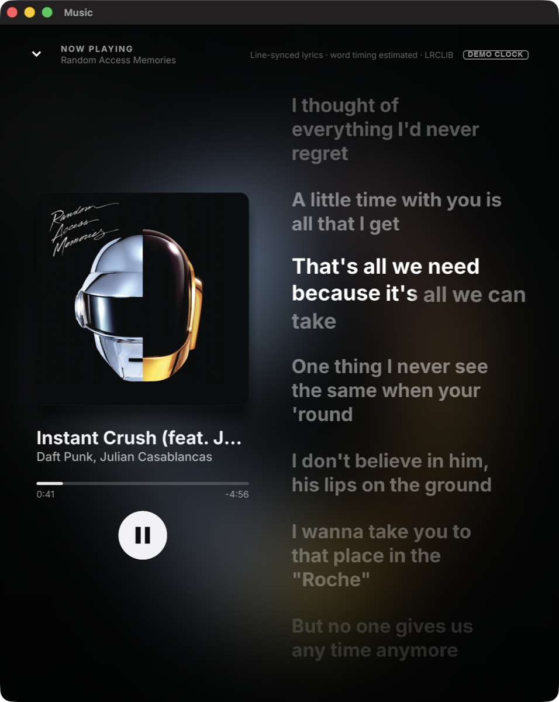
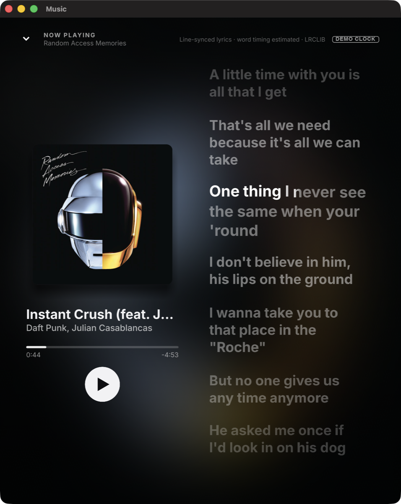
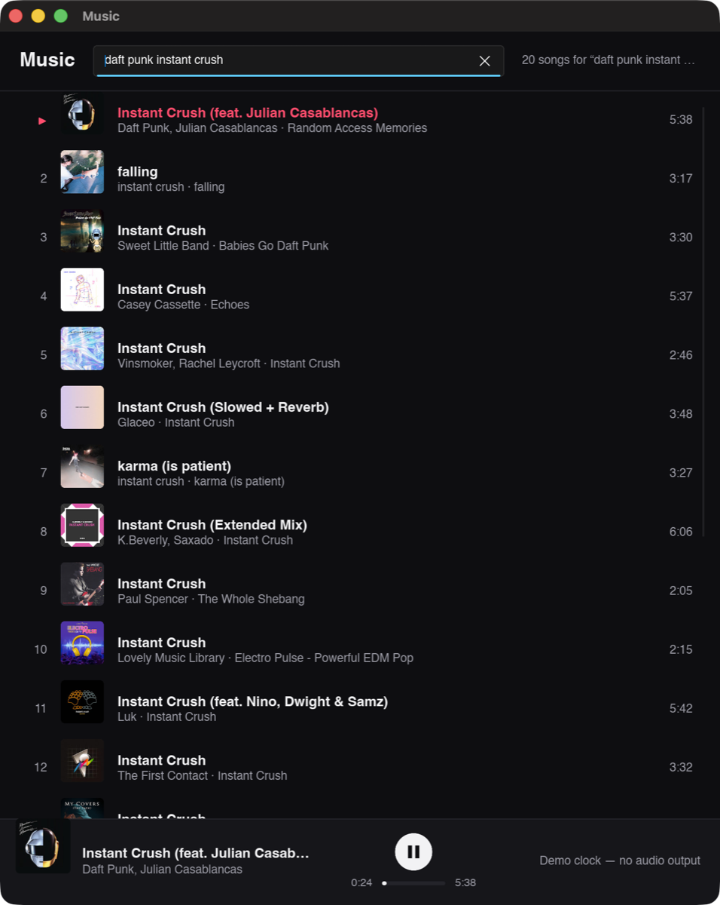

# music-macos — desktop YouTube Music client spikes

Three UI spikes on top of one shared Rust core, to pick a UI framework by
measurement instead of by opinion. All three target macOS, Windows and Linux.

| Branch | UI stack | Idea |
|---|---|---|
| `main` | — | Shared core only (`crates/music-core`) |
| `ui/slint` | Slint 1.x | Stable, declarative, accessible |
| `ui/gpui-component` | GPUI (`gpui-pre`) + gpui-component | Zed's GPU UI + 60-widget kit |
| `ui/hummingbird` | Hummingbird (GPUI, `gpui-unofficial`) | Fork an existing native GPUI music player and add YouTube Music to it |

## Shared core (`crates/music-core`)

Blocking, thread-safe, no async runtime, so every UI toolkit can drive it from
its own executor.

* `InnerTube` — anonymous YouTube Music (`WEB_REMIX`) song search.
* `StreamResolver` trait + `IosClientResolver` — video id → audio URL (AAC itag 140).
* `Player` — audio thread (rodio → Symphonia + cpal) with a pollable
  `PlaybackState`, loudness normalization from YouTube's per-format `loudnessDb`.

```sh
cargo run --release -p music-core --example resolve -- "daft punk"  # headless: search → resolve → download → decode
cargo run --release -p music-core --example cli -- "daft punk"      # plays ~8 s through the speakers
```

### Known limitation: previews only (PoToken)

Without a PoToken, googlevideo serves only the first 1 MiB of a stream and
answers 403 afterwards, so every spike plays roughly the first minute of a
track (`PlaybackState::preview_only` is set). Full playback needs a PoToken
provider behind `StreamResolver` — ArchiveTune does this with YouTube's
BotGuard challenge in a hidden WebView. That decision is deliberately left open.

## Spike spec (identical in every UI branch)

1. Window ~1100×720, dark theme.
2. Search field → `InnerTube::search_songs` on a background thread.
3. Virtualized results list: artwork (`Track::artwork_url(120)`), title,
   artists · album, duration. Click a row to play it.
4. Now-playing bar: artwork, title/artists, play/pause, progress bar with
   elapsed/total time and click-to-seek, "preview" badge when `preview_only`.
5. UI polls `Player::state()` every ~250 ms; no other cross-thread plumbing.

## How to compare

Build each branch with `cargo build --release` and record:

* Release binary size (and bundled app size where applicable).
* Idle RSS after launch, RSS with 20 results and artwork loaded, RSS while playing
  (`ps -o rss= -p <pid>` or Activity Monitor "Memory").
* CPU while playing with the window visible vs. hidden.
* Cold start to first frame, clean build time, scroll smoothness.

## Slint spike notes

```sh
cargo run --release -p music-slint                  # empty window, type a query + Enter
cargo run --release -p music-slint -- daft punk     # searches on launch (for scripted RSS runs)
```

Code: `crates/music-slint/ui/app.slint` (all UI, compiled by `slint-build` in
`build.rs`, style `fluent-dark`) + `src/main.rs` (~290 lines of glue).

**Dependencies:** `slint 1.18.1` / `slint-build 1.18.1`, `image 0.25.10`
(`jpeg`, `png`, `webp` only).

**Renderer/backends:** `default-features = false` + `std`, `compat-1-2`,
`backend-winit`, `renderer-femtovg`, `accessibility`. No Qt backend, no software
renderer, no Skia, no system tray. FemtoVG is pure Rust on OpenGL (CGL on macOS:
deprecated by Apple but works), antialiased text/paths, and needs no native
toolchain beyond the CLT. Skia looks marginally better but adds roughly 10 MB of
prebuilt C++ (or a clang/ninja/python source build), and its RAM cost was not
measured here;
`renderer-femtovg-wgpu` would use Metal but pulls in wgpu. `accessibility`
(AccessKit) costs only about 0.4 MB (15.6 MB without vs 16.0 MB with), so it stays.

**Measured** (MacBook, macOS 26, Rust 1.99, `CARGO_BUILD_JOBS=4`, other builds
running in parallel, so timings are pessimistic):

| | |
|---|---|
| Release binary (stripped, thin LTO) | **16.0 MB** (core-only `cli` example: 3.8 MB) |
| Clean release build | ~10 min (~7.5 min deps + ~2.5 min for this crate) |
| Incremental release rebuild after a `.slint`/`.rs` edit | 1.5 to 2.5 min (thin LTO + generated code) |
| Idle RSS, 8 s after launch | 89 to 103 MB |
| RSS with 20 results + artwork | 96 to 115 MB |
| RSS while playing | not measured (sandbox has no audio device) |

The window was tiled by a window manager to 1470×922 instead of 1100×720, which
slightly inflates RSS (larger GL surface).

**What works:** search on a background thread (stale responses are dropped),
virtualized `ListView` with 44 px artwork, title, artists · album, and
duration, plus the current-track highlight. Artwork goes through a 4-thread
fetch+decode pool, then becomes a `SharedPixelBuffer` and is turned into a
`slint::Image` on the UI thread, cached per video id. The now-playing bar has
artwork, title/artists, a `PREVIEW` badge, play/pause with a loading spinner,
elapsed/total, and click-to-seek. A 250 ms `slint::Timer` polls `Player::state()`.
If `Player::new` fails, the error appears in the bar and search keeps working.
Verified visually via a window capture. Playback, seek and play/pause could not
be exercised (no audio device in the sandbox).

**Easy:** the declarative layout is fast to write and type-checked at build time.
`invoke_from_event_loop` + `Weak` make the threading straightforward.
`ListView` virtualizes out of the box. Dark std-widgets need one line
(`with_style("fluent-dark")`). Clippy was clean on the first try.

**Hard / limitations hit:**
* `slint::Image` is `!Send`, and so is any `Rc` you capture, so state touched from
  `invoke_from_event_loop` closures (track list, image cache) ends up in a
  UI-thread `thread_local!`. That works, but it is the least elegant part.
* `Image::load_from_data` exists (with `image-default-formats`), but it returns
  a `!Send` `Image`, so it would decode on the UI thread. The app decodes with
  `image` on worker threads into a `Send` `SharedPixelBuffer` instead.
* No built-in way to scroll a `ListView` to the top from Rust. The workaround is
  a fresh `ModelRc` per search plus `changed results => { list.content-y = 0; }`
  in `.slint` (`viewport-y` is deprecated in 1.18).
* The compiler rejects `a || b && c` without parentheses. That is a good error,
  but it's only reported at `build.rs` time, after a long dependency build.
* Builds are heavy: the release build of the generated code plus thin LTO
  dominates the edit/compile loop. Use a debug build, or `slint-viewer` with
  live preview, for UI iteration.
* No custom fonts or icons are bundled. The play/pause glyphs are `Path`s and
  the artwork placeholder is a "♪" from the system font.

## Slint — lyrics & Now Playing round

```sh
# Searches, plays the first hit on the wall-clock demo clock and opens Now Playing:
MUSIC_QUERY="daft punk instant crush" MUSIC_AUTOOPEN=1 MUSIC_DEMO_CLOCK=1 \
  cargo run --release -p music-slint
# Same app without AccessKit (see "Measurements"):
cargo build --release -p music-slint --no-default-features
# Baseline: an empty Slint window redrawing every frame
cargo run --release -p music-slint --example redraw_baseline
```

| Now Playing, mid-lyric (three-row active line, lit across the first row break) | Paused (artwork shrunk, sweep frozen mid-word) | Closed (results + bar) |
|---|---|---|
|  |  |  |

The window manager tiled the window to 735×922 for these captures. The window
was captured by id with `screencapture -l`.

Code: `ui/app.slint` (+628/−39 lines), `src/playback.rs` (200, demo clock +
clock smoothing), `src/now_playing.rs` (161, artwork/blur/lyrics loading),
`src/lyrics_layout.rs` (119, word measurement + wrapping), `src/main.rs`
(+120/−71), `examples/redraw_baseline.rs` (21). That is about **600 lines of
Rust and 590 lines of `.slint`** for this feature. Inter (OFL, 0.5 MB, the
same file Slint ships as its wasm fallback) is bundled in `ui/fonts/`.
Release binary: 17.7 MB (16.0 MB before; the font is embedded twice, once by
`slint-build` and once by `include_bytes!` for the measurer).

### Spec status

1. **Open/close: done.** A `TouchArea` under the whole now-playing bar (the
   controls sit on top of it) calls `open-now-playing()`. The overlay slides up
   the full window height in 320 ms (`cubic-bezier(0.22, 1, 0.36, 1)`, an
   ease-out) while its content fades in. The chevron and Escape run the same
   animation in reverse, and Space toggles play/pause. Verified at runtime:
   autoopen, Escape and Space, using key events posted to the process. *Not*
   verified at runtime: mouse paths (bar click, chevron, seek bar, line click).
   Posted mouse events are ignored in this sandbox, and `osascript` may not send
   input.
2. **Blurred background: done.** A worker thread fetches the 544 px artwork,
   downscales it to 128², runs a gaussian blur (σ = 9, about 40 px at 544 px),
   boosts saturation ×1.35, and hands back a `SharedPixelBuffer`. The GPU
   upscales it bilinearly, which keeps it smooth. Two `Image` layers cross-fade
   over 500 ms (the new image goes on the hidden layer, then `bg-b-front`
   flips), under two gradient overlays. The first track fades in from black.
   A track-to-track cross-fade was not captured on screen, because the demo
   only ever plays one track.
3. **Left column: done.** The artwork scales 1.0 when playing and 0.92 when
   paused (500 ms, overshooting cubic-bezier), with a 48 px drop shadow. Below
   it: title, artists, seek bar with elapsed/remaining time and click-to-seek,
   and a 64 px play button. Its icon is two `Path`s that cross-fade, rotate
   ±90° and scale into each other (280 ms).
4. **Lyrics: done.**
   * `fetch_lyrics` runs on a thread and results for stale tracks are dropped.
     States: spinner + "Loading lyrics…", "No synced lyrics", or an error.
     The header says whether timings are word-synced or estimated.
   * The active line scrolls to 30 % of the pane height (`animate scroll`,
     480 ms, ease-out bezier).
   * **Karaoke level: a true partial left-to-right sweep inside each word,
     with a soft 16 px edge, and it survives wrapping.** Every word is its own
     `Text`. On the active line its `color` is
     `@linear-gradient(90deg, #fff 0%, #fff lit-stop, #fff6b edge, #fff6b 100%)`,
     and the stop positions are bindings on `word_progress` (Slint allows
     expressions as gradient stops, and FemtoVG fills glyph runs with gradient
     paints). One element per word, no clipping layers. Words also lift 2 px
     while sung. The paused screenshot shows the sweep frozen inside "never",
     and the other shows a three-row active line lit across its first row
     break.
   * **Word wrapping:** Slint has no flow layout and no text-measurement API
     from Rust, so `lyrics_layout.rs` measures each word with **Parley 0.11.1**.
     That is the shaping/layout engine Slint 1.18 uses internally, already in
     the dependency tree, so it adds no crates. It measures against the same
     bundled Inter at weight 700 that the `.slint` side renders with, then
     greedily breaks at word boundaries and sends `{x, y, w, start, end}` per
     word. Measured and rendered advances therefore come from the same engine
     and font. `changed lyrics-width` / `changed lyrics-font-size` call back
     into Rust to re-flow on resize. The font size steps with the column width
     (28–44 px, whole pixels).
   * Inactive lines: `transform-scale` 0.9 (origin left-centre). Alpha drops
     with distance from the active line (0.46 at distance 1, down to 0.12), and
     both animate over 450 ms. Lines fade out within 90 px of the pane edges, a
     stand-in for a mask. Hovering brightens a line.
   * Each line has a `TouchArea` that calls `seek-to(line.start)`.
5. **Clock: done.** The `.slint` side computes
   `pos = clock-base + (animation-tick() - clock-anchor) / 1s`, but only while
   playing *and* Now Playing is visible. That is the only per-frame code; Rust
   does nothing per frame. The 250 ms poll calls `sync-clock(secs)` through
   `ClockSync`, which slews out 20 % of small errors per poll and snaps on
   errors over 350 ms, play/pause changes or seeks. A seek holds polled
   positions for 500 ms so a stale audio-thread position can't snap back. Line
   activation is frame-accurate: each line computes `active` from `pos`, and a
   `changed active` handler moves `active-line`, which drives the scroll and the
   distance fade. `MUSIC_DEMO_CLOCK=1`, or a failed `Player::new`, swaps in a
   wall-clock `DemoClock` that starts at 20 s and loops at the track length.
   Pause and seek work on it too, and a "DEMO CLOCK" badge is shown.
6. **Scripting hooks: done.** `MUSIC_QUERY`, `MUSIC_AUTOOPEN=1`
   (`invoke_play(0)` + `invoke_open_now_playing()` after the first results
   arrive) and `MUSIC_DEMO_CLOCK=1`. The CLI query argument still works.
7. **Idle: done, and measured at 0.0 % CPU.** Nothing reads `animation-tick()`
   unless Now Playing is open and playing. Idle polls with no change don't
   touch the UI. With Now Playing open but paused, CPU is also 0.0 %. With the
   screen closed while playing, the 250 ms poll redraws the bar at 4 Hz.

### Measurements

MacBook Air M4 (60 Hz), macOS 26, Rust 1.99. Another agent's builds were
running in parallel, so the machine was loaded (load average 5–9). Each row is
`ps -o %cpu=,rss=` sampled once a second. fps comes from
`SLINT_DEBUG_PERFORMANCE=refresh_lazy,console`. The window manager placed and
sized the window differently on every launch (735×922 or 1470×922, sometimes
off-screen), which adds noise.

| Scenario | Window | CPU % min / avg / max | RSS MB min / avg / max | fps |
|---|---|---|---|---|
| Now Playing, lyrics animating, **release (AccessKit on)**, 20 s | 735×922 | 60.1 / **79.4** / 90.5 | 138 / 139 / 141 | 53–61, mostly 57–60 |
| Same, earlier runs (window off-screen) | 735 and 1470 wide | 69–80 avg | 140–158 | dips to 37–46 |
| Now Playing, lyrics animating, **no AccessKit** (`--no-default-features`, thin LTO off), 25 s | 735×922 | 10.1 / **18.7** / 29.8 | 111 / 128 / 135 | 60 (one 52) |
| Baseline: empty window, one rect animated by `animation-tick()` | 735 and 1470 | 4.4 / 5–7 / 13.4 | 90 | 60 |
| Now Playing open, paused | — | 0.0 | ~150 | — |
| Closed, still playing (4 Hz bar updates) | 735×922 | 4.6 / 15.8 / 46.5 | 154 | — |
| Closed, idle, 20 results + artwork | 735×922 | 0.0 / 0.0 / 0.1 | 112.6 | — |
| Closed, idle, empty window | 735×922 | 0.0 / 0.0 / 0.1 | 100.3 | — |

**AccessKit is the dominant cost.** The tiling window manager is an
accessibility client, so Slint's AccessKit bridge is active. A `sample`
profile of an unstripped build showed `AccessKitAdapter::rebuild_tree_of_dirty_nodes`
taking about 1045 samples in 5 s, against about 400 for all FemtoVG rendering.
Every accessible node whose geometry or text depends on something animated is
rebuilt every frame. Mitigations applied:
* `accessible-role: none` on the per-word `Text`s and the lines.
* A single accessible node on the lyrics pane that carries the current line.

Together these took about 20 points off, but about 60 points remain, and they
cause the fps dips. Built without the `accessibility` feature, the same screen
uses 18.7 % CPU at a steady 60 fps. With no accessibility client attached the
bridge should stay inactive, but that could not be tested here.
`accessibility` is now a default-on crate feature so both builds are one flag
apart.

Without AccessKit, the remaining 10–30 % comes from the full-window redraw.
Most of it is rendering about 150 visible text items through FemtoVG on
OpenGL-on-Metal at 2× scale, plus binding evaluation for 80 lines × ~8 words
per frame. Two optimizations are in:
* Off-screen lines get `visible: false`, so the renderer doesn't traverse their
  words.
* The main UI under the opaque overlay is hidden once the slide finishes.

Jank: no visible stutter in the captures. The fps counter shows 57–60 with
occasional 52–53 frames, and 37–46 only in the AccessKit-active runs where the
window was positioned off-screen.

### Easy

* Declarative motion is excellent for this kind of screen. `animate` works on
  any property, including private computed ones (`zoom`, `alpha`, `scroll`,
  `np-t`), with cubic-bezier easings. `transform-scale`, `transform-rotation`
  and `transform-origin` work on any element except a component's root.
  `changed prop => {}` handlers give frame-accurate reactions.
* `animation-tick()` gave refresh-rate interpolation with zero per-frame Rust
  code. Because redraw is dependency-driven, the app idles at 0 % with no
  extra work.
* Gradient brushes with **bound stop positions** made the in-word sweep a
  single-element effect. No clip layers, no shaders.
* Threading stayed simple: workers produce `SharedPixelBuffer`/`Lyrics`, and
  `invoke_from_event_loop` brings them back to the UI thread. The Rust side
  compiled and passed clippy on the first try.

### Hard, and the workarounds

* **No flow/wrap layout and no text measurement from Rust.** Worked around
  by measuring in Rust with Parley plus a bundled font, as described under
  spec item 4. It works, but it relies on Slint *using* Parley internally,
  which is not a public contract. A Slint upgrade that changes shaping could
  misalign word positions by a pixel or two (each word gets 4 px of slack).
* **No masks, no blur or backdrop filters, no glow.** The background blur is
  done on the CPU. The fade at the pane edges is emulated with per-line alpha.
  Far lines are not blurred, which Apple Music does and ArchiveTune
  approximates. The active words have no glow.
* `opacity` on a container renders an offscreen layer every frame, so line
  dimming is folded into the text colour alpha instead.
* Animations are duration + easing only. There are no physics springs (the
  overshoot is a bezier) and no per-item staggered or spring scroll like Apple
  Music's.
* Compiler gotchas:
  * Transforms on a component's root element are ignored with a warning.
  * Layout children that reference `root.width` form binding loops: one is an
    error, one a deprecation warning. Fixed by deriving sizes from the window
    height, or with `max-width` + stretch.
* No user scrolling of the lyrics (the pane owns its own scroll offset, and
  there was no time to add wheel handling plus a snap-back timer).
* Performance work needed an unstripped custom profile plus `sample`. Slint has
  no built-in frame profiler beyond the fps counter.
* Iteration speed: every `.slint` edit costs a 1–2.5 min release rebuild.

### Missing framework features (for this screen)

A flow/wrap layout, or a public text-measurement API. Alpha masks, gradient
masks, blur and backdrop filters, shaders. Text shadow or glow. Spring
animations, staggered animations, animation completion callbacks. A
programmatic scroll API for `Flickable`/`ListView`. Cheaper AccessKit updates
for animated subtrees, or a way to mark a subtree as decorative or
non-accessible.
