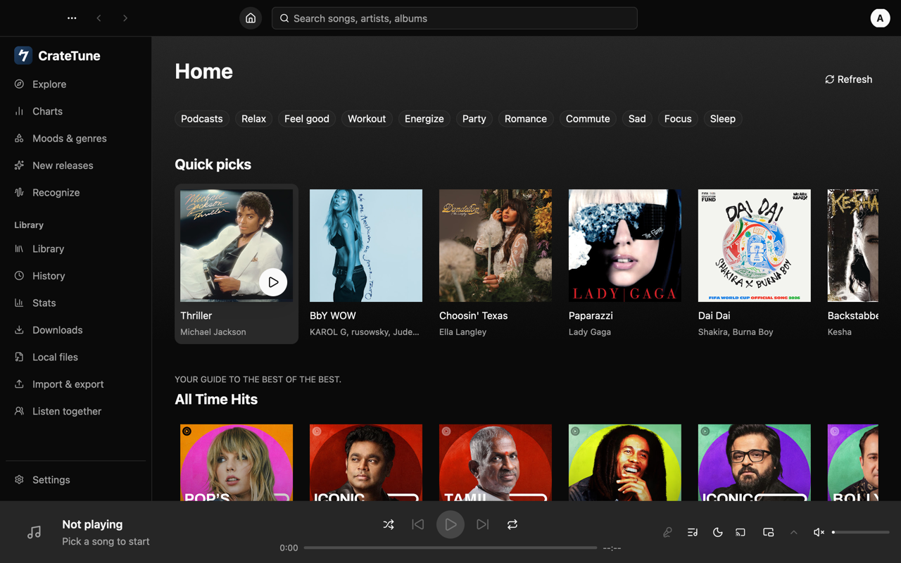
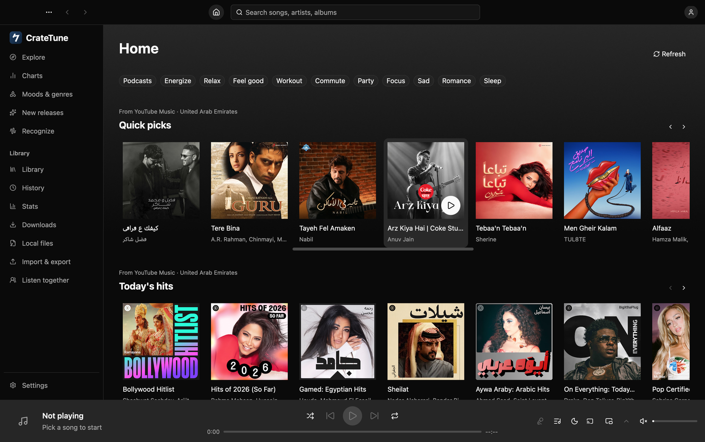
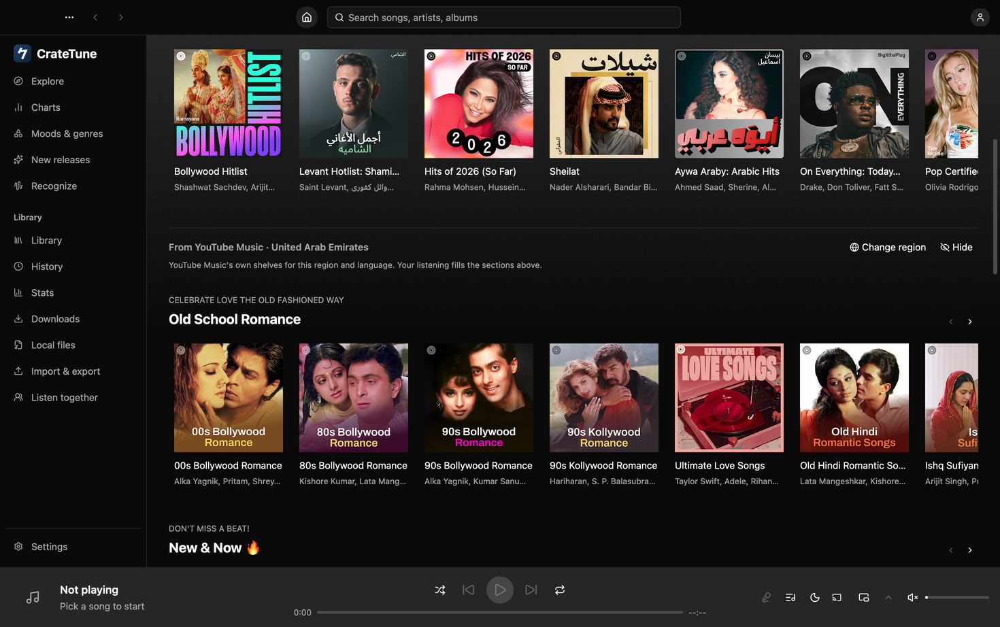
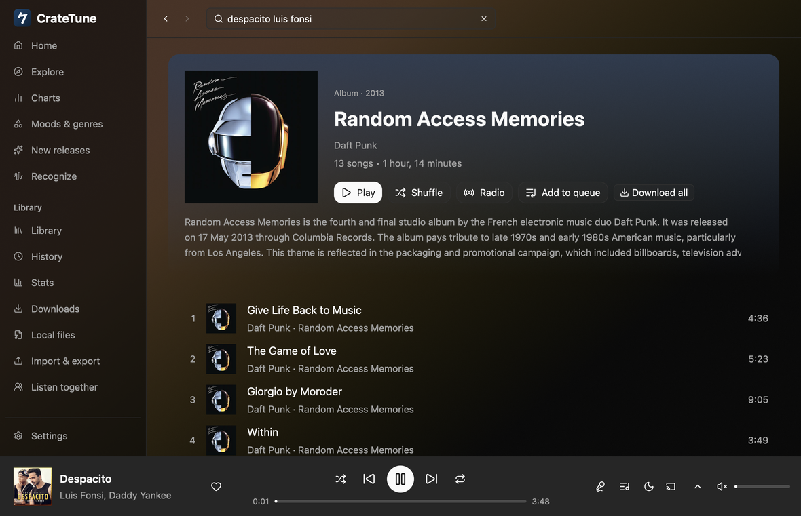

# User guide

CrateTune is a native desktop player for YouTube Music on
macOS, Windows and Linux. It is free software (GPL-3.0) and not affiliated with YouTube,
Google or Shazam.

* [Install](#install)
* [First start](#first-start)
* [Finding music](#finding-music)
* [Playing](#playing)
* [Now Playing and lyrics](#now-playing-and-lyrics)
* [Recognize music](#recognize-music)
* [Library](#library)
* [Your own music files](#your-own-music-files)
* [Signing in](#signing-in)
* [Settings](#settings)
* [Themes and profiles](#themes-and-profiles)
* [Keyboard shortcuts](#keyboard-shortcuts)
* [Modules](#modules)
* [Listen together](#listen-together)
* [Cast to a TV or speaker](#cast-to-a-tv-or-speaker)
* [AI content filter](#ai-content-filter)
* [Updates](#updates)
* [Privacy](#privacy)
* [Known limitations](#known-limitations)
* [Troubleshooting](#troubleshooting)

## Install

**macOS (11 Big Sur or later).** Open the `.dmg` and drag the app to Applications.
Builds that aren't signed with a Developer ID (the default, including the GitHub
releases for now) are refused by Gatekeeper on first open ("Apple could not verify…"):
click **Done**, then System Settings → Privacy & Security → **Open Anyway** (on macOS 14
and earlier, right-click the app → **Open** also works). Or, in Terminal:
`xattr -dr com.apple.quarantine /Applications/CrateTune.app`. The first time you
recognize a song, macOS asks for microphone access.

**Windows 10/11 (x64).** Run the `…-setup.exe` (installs for the current user, no admin
rights) or unpack the `.zip` anywhere and start the `.exe`. SmartScreen may warn about an
unsigned download: **More info → Run anyway**.

**Linux (x86_64).** Either the AppImage (`chmod +x …AppImage` and run it) or the
`.tar.gz`: unpack it and run `./install.sh` (installs into `~/.local`; `PREFIX=/usr/local
sudo ./install.sh` for everyone). The app needs a Vulkan driver, Wayland or X11,
fontconfig, ALSA and D-Bus (all standard on desktop distributions).

**From source:** see "Install / build" in the [README](../README.md#install--build).

## First start

A short guide opens on the first start: the app's language, content language and
country, theme, optional
YouTube Music sign-in, optional music folders, and a note about privacy and previews.
Everything can be skipped (**Skip setup**, or Esc) and changed later in Settings. Open
the guide again from **Settings → About → Show welcome guide**.

## Language

The app is translated into English, Deutsch, Español, Français, Italiano, Nederlands,
Polski, Português (Brasil), Русский, Українська, Türkçe, Bahasa Indonesia, Tiếng Việt,
日本語, 한국어, 简体中文, 繁體中文 and हिन्दी. By default it follows your system's
preferred languages (macOS: System Settings → General → Language & Region; Windows: the
display language; Linux: `LANGUAGE` / `LANG`), falling back to English. Pick another one
in **Settings → Appearance → Interface language** (or on the guide's first page); the
switch is immediate, menus included. Dates, counts ("1 song" / "5 songs") and number
grouping follow the language; playback times stay `m:ss`.

The language of titles, shelves and search results comes from YouTube Music and is a
separate setting (**Content & region → Content language**). On a fresh install it starts
in the app's language and your system's region.

## The top bar

Across the top of the window, left to right:

* **⋯** — Settings, Keyboard shortcuts, Check for Updates, About and Quit (on a Mac also
  in the menu bar).
* **← →** — back and forward (⌘[ / ⌘], or the mouse's back / forward buttons).
* **Home** and the **search field** in the middle (⌘F jumps to it).
* **Your account** on the right: your name, **Account settings**, **Sync now** and **Sign
  out**; when you aren't signed in, **Sign in** (it opens Settings → Account).
* **Window buttons.** On a Mac the usual red / yellow / green buttons sit at the left of
  the bar (in full screen they hide). On Windows: minimise, maximise / restore and close at
  the right; hover maximise for the Windows 11 snap layouts. On Linux: round buttons at the
  right when your desktop lets apps draw their own title bar.

Drag the empty part of the bar to move the window; double-click it to maximise (on a Mac,
what System Settings → Desktop & Dock says for a title bar double-click). The bar stays
above Now Playing, so the window buttons are always there (in full screen Now Playing fills
the whole window).

Prefer the system's title bar? **Settings → Appearance → Window → Use the system title
bar** brings back the operating system's title bar with back, forward and search above the
page. It takes effect the next time the app starts; **Restart now** does it right away.

## Finding music

* **Search** (⌘F, the field in the top bar): type to get suggestions (songs, artists, albums) and recent searches;
  ↑/↓ and Enter pick one. The search page has an **All** overview and tabs for songs,
  videos, albums, artists, playlists, podcasts and episodes; more results load as you
  scroll. When YouTube corrects a typo, the page says **Showing results for …** with a
  **Search instead for …** link (or **Did you mean …?**); recent searches keep what you
  typed.
* **Home** is made for you, like ArchiveTune's: **Quick picks** (songs related to the
  ones you play most), **Speed dial** (what you pinned with **Pin to speed dial** in a
  right-click menu), **Keep listening**, **Your YouTube playlists** (signed in),
  **Forgotten favourites** (songs you loved and haven't played for a month), **Similar
  to …** rows for artists and songs you play a lot, then YouTube Music's feed with its mood
  chips. Before you have listened to anything, Home shows YouTube Music's quick picks and
  feed for your content language and country. **Refresh** (next to the title) brings new
  picks; Home also refreshes by itself when you open it after 20 minutes. Choose what
  quick picks are based on, their layout, the chips, the tonal backdrop and which sections
  show in **Settings → Content & region → Home**.
  Below your own sections, **From YouTube Music · <country>** marks where YouTube Music's
  feed starts: those shelves (and YouTube's quick picks before you have history) are what
  YouTube Music shows in your **content country and language**. A first run takes the
  country from your system's region (e.g. a Mac set to English (UAE) gets the UAE feed);
  **Change region** opens Settings → Content & region, **Hide** hides the feed (show it
  again under Settings → Content & region → Home → Sections).
* **Rows that scroll sideways** (shelves, quick picks, chips): use the **‹ ›** buttons
  next to a shelf's title, **Shift + mouse wheel** or a sideways trackpad swipe / tilt
  wheel over the row, **drag** the row with the mouse (a click without moving still opens
  or plays the card), or the thin scrollbar that appears under a hovered row. The plain
  wheel scrolls the page.

  

  

* **Explore**, **Charts** (pick a country), **Moods & genres** and **New releases** show
  the rest.
* Artist, album and playlist pages have Play, Shuffle, Radio and Add to queue. Long
  albums (over 200 tracks) load the rest of their tracks automatically.
* **Podcasts**: a show's page (from search, Home or Explore) has its description, Play /
  Shuffle / Add to queue, **Save to library** (signed in) and the episodes with date,
  length and description — more load as you scroll. Click an episode to play it;
  right-click → **Open episode page** for its full description. Saved shows are in
  Library → **Podcasts** (signed in).
* Right-click any song (or use "…") for play next, add to queue, start radio, add to
  playlist, like, download, go to artist / album.

## Playing

* The player bar at the bottom: artwork, title and artist (click to open Now Playing),
  like; shuffle / previous / play / next / repeat with the progress bar below (click or
  drag to seek; hovering shows the time under the pointer; click the time on the right
  to switch between the remaining time and the song's length); lyrics, queue, sleep
  timer, Cast, mini player, Now Playing and the volume on the right (click the speaker
  to mute; scroll over it or the slider to change the volume). In a narrow window the
  less important buttons hide first. Messages such as "Loading…" or a skipped song
  appear under the artist.
* **Player bar look** (Settings → Appearance → Player bar): progress bar style —
  Standard, Thick, Simple, **Wavy** (an animated wave), **Equalizer** (bars that move
  with the music) or **Waveform** (the song's loudness shape as bars, like SoundCloud:
  quiet intros are low, choruses tall; it doesn't move, only the played part fills in;
  until the shape is known — the first seconds of a new song — a flat row of low bars
  stands in, then the shape fades in once) — and **Background reacts to playback**: *Artwork glow*, *Dynamic
  gradient* (direction, intensity, optional slow animation) or *Pulse* (follows the
  loudness), dimmed while paused unless you turn that off. Also: show the remaining
  time, scroll to change the volume, the same look in the mini player, and a visualizer
  strip in Now Playing. The bar is static by default; the moving styles use a few
  percent of CPU while music plays and stop when it pauses. Waveform is static too: each
  song is read once in the background (a fraction of a second of CPU) and its shape is
  kept (a few hundred bytes per song), so playing it again costs nothing. The
  **Minimal / Fast** profile switches all of it to the cheapest look.
* **Choose what the bar shows**: right-click the bar (or Settings → Appearance → Player
  bar → *Show on the bar*) and tick or untick like, the source / quality tag, shuffle,
  repeat, the SponsorBlock prompt, the Music Together status, lyrics, **Add to playlist**
  (off at first; a button beside the heart that opens the playlist picker for the
  playing song), queue, sleep timer, Cast, mini player, Now Playing and the volume
  slider. Hidden buttons leave no gap, and the room goes to the next buttons when the
  window is narrow. A Cast session in progress and an armed sleep timer stay visible so
  you can stop them. *Reset* brings back the usual bar. The mini player is not affected:
  it has its own fixed buttons.
* **Change the quality from the bar**: click the tag beside the transport ("YouTube ·
  AAC 128 kbps") and pick Low, Normal or High. The playing song switches at once, from
  the same moment, without a pause (the tag shows a spinner meanwhile); the choice is
  saved just like Settings → Playback → Streaming quality. Your own files and downloads
  keep their format (the menu says so); while casting, it applies from the next song.
* **Queue** (⌥⌘Q): now playing, up next (drag to reorder, remove), history. Shuffle (⌘S)
  and repeat off / all / one (⌘R) are remembered.
* **Radio** plays an endless mix based on a song, artist, album or playlist.
  **Autoplay similar songs** (Settings → Content & region) keeps playing related songs
  when the queue ends.
* **Mini player** (⇧⌘M): a small window that stays on top; click or drag its progress
  bar to seek. On Windows and Linux, drag its top strip to move it; × closes it.
* **Sleep timer**: the moon button in the bar — 5 to 60 minutes, end of the song, or a
  custom length.
* **Media keys** and the system's now-playing controls work on all three systems; on
  macOS there is also a menu-bar item, on Windows an icon in the notification area (right
  click: the menu; left click: show the window).
* **Windows / Linux:** the **⋯** button at the right of the header has Settings, Keyboard
  shortcuts, Check for Updates, About and Quit (on macOS they are in the menu bar).
  Starting CrateTune on Windows while it runs brings its window to the front.
* **Mouse wheel** (Windows, Linux): each notch scrolls smoothly (about 3 lines); with
  Motion set to Off it jumps at once. Trackpads scroll as before.

## Now Playing and lyrics

Open with ⌘L or by clicking the bar's title. Eight designs, from the design menu in its
header or Settings → Appearance:

* **Split** — artwork and controls beside the lyrics; **Big artwork** — centered, with the
  current lyric line; **Lyrics first** — lyrics across the screen, controls in a strip;
* **Immersive** — the artwork across the top fading into black, big title, icon controls;
* **Card** — a floating card with the artwork, the audio format and a volume slider;
* **Minimal** — just the title and the time; the window fills with colour as the song plays;
* **Editorial** — two colours from the artwork, a round cover, a large PLAY / PAUSE button;
* **With queue** — artwork and controls beside the next songs (click one to play it).

Four backgrounds (blurred artwork, gradient, solid, glow) apply to the designs that don't
bring their own colours (Immersive, Minimal and Editorial do).

**Full screen**: the full-screen button in the header (four corners, top right) (or ⌃⌘F on macOS, F11 on Windows and Linux)
puts the window in full screen and back; on a Mac that is native full screen, in its own
Space. To have it every time, turn on Settings → Appearance → Now Playing → **Full screen
when Now Playing opens** (also for the lyrics view). Closing Now Playing (Esc, the close
button, ⌘L or going to another page) leaves full screen again, but only when the app
entered it for Now Playing: if the window was already in full screen, it stays. With the
button, the first Esc leaves full screen and the second closes Now Playing; with the
setting, one Esc does both. If you leave full screen yourself (the green button), the app
doesn't put it back. The mini player keeps working on top of the full-screen window.

**Lyrics cards**: click the share button above the lyrics, click up to six lines, then
**Create card…**. Pick a background (blurred artwork, album colour, dark, light), the text
alignment and size, square / portrait / story shape and whether the cover shows, then
**Save image…** (PNG) or **Copy image** to paste it elsewhere. Cancel (or Esc) leaves the
selection.

Lyrics come from several providers (word-by-word where available). Click a line to jump
there. Songwriter / producer credits that some providers put above the lyrics are left out,
and songs the providers know as instrumentals show no lyrics. Translation (Google or your
own AI endpoint) and romanization (Japanese, Korean, Chinese, Hindi, Cyrillic, …) are in
Settings → Lyrics. A song is translated once per language and kept, so opening it again
doesn't wait for the translator.

**Kanji in Japanese romanization** need a dictionary: Settings → Lyrics → Romanization →
**Kanji readings** → Download (10.5 MB, about 45 MB on disk; it also starts when you turn
Japanese romanization on). Until it is there, only kana are romanized and kanji stay as
they are. Remove deletes it again.

## Recognize music

**Recognize** in the sidebar (or ⇧⌘R, or View → Recognize Song) listens through the
microphone for about 10 seconds and identifies the song. The result shows title, artist,
album, artwork and links (Shazam, Apple Music, Spotify, YouTube) and searches YouTube
Music for it: **Play**, **Add to queue**, **Radio** or **Search**. Click the button again
(or **Cancel**) to stop listening early.

Recognized songs are kept in a history below (newest first, up to 50); click one to see it
again, × removes it, **Clear** empties the list.

Only an audio fingerprint (frequency peaks, a few hundred bytes) is sent to Shazam's
service — never the recording. If access was denied, **Open privacy settings** jumps to
the system's microphone settings (macOS: System Settings → Privacy & Security →
Microphone).

## Library

Everything is stored locally (SQLite database in the settings folder):

* **Library** — songs you added, liked songs, albums, artists, playlists, downloads and
  local files, with filters, sorting and multi-select (**Select**).
* **Playlists** — create local playlists (and, when signed in, YouTube Music playlists),
  rename, reorder, delete. Your own YouTube Music playlists get **Change cover…** (any
  JPEG / PNG / WebP; cropped to a square and uploaded).
* **History** — every song you listened to for at least 30 s, by day.
* **Stats** — listening time, top songs / artists / albums, by hour and weekday; **Year in
  Music** per year.
* **Downloads** — downloaded songs play from disk (see the limitation below).
* **Download all** — Liked songs, library songs, your playlists, YouTube playlists and
  albums have a **Download all** button in their header. While songs download it shows
  "Downloading N of M" with **Cancel**; when everything is downloaded it turns into
  **Remove downloads**. Songs download two at a time, so even long lists don't flood the
  network. Local files are never downloaded (they are already on your computer).
* **Download liked songs** — Settings → Storage → Downloads: with **Download liked
  songs** on, liking a song downloads it. **Remove download when unliked** (off by
  default) deletes the download again when you unlike the song.

## Your own music files

**Local files** in the sidebar (or the onboarding guide): add music folders, then
**Rescan**. MP3, M4A/AAC/ALAC, FLAC, Ogg Vorbis/Opus, WAV and AIFF are read with their
tags, cover art, embedded lyrics and ReplayGain. Local songs show up in the library and
play in full.

## Signing in

Optional — browsing, search and playback work without an account. Signing in adds your
likes, library, playlists, subscriptions and personalized recommendations.

* **macOS and Windows:** Settings → Account → **Sign in with Google…** opens Google's
  sign-in page in a window; when you reach YouTube Music the window closes. On Windows the
  window uses the Microsoft Edge WebView2 Runtime (part of Windows 10/11); if it is
  missing, the app says so and opens **Paste cookie…** instead. The window keeps its own
  browser profile with your Google session (like a browser would), so CrateTune can renew
  your YouTube Music sign-in in the background; **Sign out** deletes it.
* **Everywhere:** **Sign in from your browser…** takes the sign-in of a browser on this
  computer where you're signed in to YouTube Music (see
  [Sign in from your browser](#sign-in-from-your-browser)).
* **Everywhere (and on Linux):** **Paste cookie…** — copy the `Cookie` request header of
  music.youtube.com from your browser's developer tools (step-by-step instructions are in
  the dialog).

The sign-in cookie is stored in the system keychain and only sent to YouTube. **Sync now**
copies your YouTube Music library into the local one; **Sign out** forgets the cookie
and the sign-in window's Google session (the synced data stays).

**Staying signed in.** Google keeps renewing parts of the sign-in cookie while you use
YouTube Music; CrateTune takes those updates like a browser and saves them (at most once a
minute). If YouTube Music still rejects the sign-in, CrateTune first tries to renew it in
the background from the sign-in window's profile, without showing anything. Only if that
fails does it say **"Your YouTube Music sign-in expired"**, with a **Sign in again** button
(also in Settings → Account). Until then likes and dislikes are kept here and sent after you
sign in again; browsing keeps working, signed out. On Linux (paste-cookie sign-in) there is
no background renewal: paste a fresh cookie when asked.

**Several Google accounts in one login.** Like youtube.com, one browser login can hold
several Google accounts. If yours does, Settings → Account → Accounts lists them by name and
e-mail; pick the one CrateTune should use. If it holds just one, a note says so instead.
**Channels** (brand accounts) of the Google account in use are listed below it. If a switch
fails, CrateTune stays on the account you had and tells you why. To keep accounts of
*different* logins side by side, see [Several accounts](#several-accounts).

### Several accounts

You can stay signed in to several YouTube Music accounts and switch between them in one
click:

* **Add one:** Settings → Account → **Your accounts** → *Add an account*, or **Add
  account…** in the account menu of the top bar. Sign in with any of the usual ways
  (**Sign in with Google…**, **Sign in from your browser…**, **Paste cookie…**). The new
  account is added and becomes the one in use; the previous one stays in the list. Signing in
  again to an account that is already in the list just renews it.
* **Switch:** click another account in the top bar's account menu, or **Switch** next to it
  in Settings → Account. The switch is instant: Home, your library pages and recommendations
  reload for that account, and its liked songs, saved albums, subscriptions and playlists are
  synced from YouTube Music.
* **Remove:** the **×** next to an account in Settings → Account deletes its saved sign-in.
  **Sign out** removes the account in use and switches to the most recently added other one.

What belongs to which account: **liked songs, the library songs, saved albums,
subscriptions and your YouTube playlists** follow the account in use (YouTube Music keeps
them, and a switch syncs them again). **Local files, local playlists, play history and
statistics, downloads, search history and settings** are shared by all accounts, and a
switch never deletes them. Likes or dislikes that couldn't reach YouTube yet stay with the
account they were made with and are sent when you switch back to it.

Each account that signed in with **Sign in with Google…** keeps its own sign-in profile, so
its session can be renewed in the background without mixing up accounts (on macOS 11–13
there is one profile for the app: only the account that signed in through the window last
can be renewed there). Each account's sign-in is kept in the system keychain on its own.

### Sign in from your browser

If you're already signed in to music.youtube.com in a browser on this computer,
**Sign in from your browser…** (Settings → Account) signs you in with that browser's YouTube
sign-in: pick the browser and profile from the list, CrateTune reads only its youtube.com
cookies (on this computer, nothing is uploaded), checks the account with YouTube and keeps
the sign-in in the keychain.

| | macOS | Windows | Linux |
|---|---|---|---|
| Chrome, Edge, Brave, Vivaldi, Opera, Chromium | ✓ (asks for keychain access) | only browsers without app-bound encryption (see below) | ✓ |
| Arc | ✓ (asks for keychain access) | only without app-bound encryption | — |
| Firefox | ✓ | ✓ | ✓ |
| Safari | ✓ with Full Disk Access | — | — |

* **macOS** asks whether CrateTune may use "*Browser* Safe Storage" from your keychain. That
  is expected: it's the key the browser encrypts its cookies with. Choose **Allow**. Safari
  keeps its cookies where apps need **Full Disk Access** (System Settings → Privacy &
  Security → Full Disk Access).
* **Windows:** recent Chrome, Edge and Brave lock their cookies to themselves (*app-bound
  encryption*), so no other app can read them. Such profiles are listed as locked; use
  Firefox, **Sign in with Google…** or **Paste cookie…** instead. A Chromium browser that is
  running may keep its cookies locked: quit it and try again.
* **Linux:** the cookie key comes from the keyring (GNOME Keyring via `secret-tool`, or
  KWallet), else Chromium's built-in fallbacks.

This was tested with sample cookie files only, not yet with real browser profiles.

### Plays on your other devices

Signed in, **Add plays to my YouTube history** (Settings → Account → Library sync; on by
default) adds the songs you play in CrateTune to your YouTube Music history, as YouTube
Music and ArchiveTune do: they show up on your phone and in your recommendations. Nothing is
sent for local files or while your listening history is paused (Settings → Privacy).

The other way round, **Home** shows a small **"Jump back in"** card when the newest song in
your YouTube Music history was played somewhere else (your phone, another computer): it
says "played on another device", and **Resume** plays it with its radio as the queue.
Podcast episodes and long videos continue where YouTube says you stopped, when it says so;
songs start from the beginning (YouTube doesn't keep a position for them). Dismiss the card
with **×**. Both need the same Google account on both devices.

Not yet tried with a real account: whether YouTube files these plays, and whether its
history carries the saved positions.

### Likes and YouTube

Signed in, the heart and YouTube Music's thumbs up are the same thing, both ways:

* **Liking here** likes the song on YouTube Music (and adds it to your library). If
  YouTube Music can't be reached, the like is kept here and sent later (every few
  minutes, and before each sync) — the toast says so. If your sign-in expired, the toast
  says that instead and the like waits until you sign in again.
* **Liked elsewhere** (phone, browser, ArchiveTune) shows up here by itself: CrateTune
  syncs your liked songs when it starts (unless it just did), every 45 minutes, when you
  come back to the window after a while and when you open the Liked tab; the whole
  library every 6 hours, and right after signing in or switching account. A song you
  play also asks YouTube Music for its like or dislike a few seconds in, so a song liked
  on your phone shows the filled heart as soon as you play it.
* **Unliked elsewhere**: the next sync removes it from Liked songs. YouTube Music is the
  source of truth; your local files keep their likes.
* **Dislike** (thumbs down): in a song's menu, beside the heart on Now Playing (Split
  design), and as an optional player-bar button (Settings → Player bar). It dislikes the
  song on YouTube Music, removes a like, skips the song if it is playing (turn off with
  **Skip songs you dislike**), and keeps it out of radio and autoplay. Choose **Remove
  dislike** to take it back. YouTube Music has no list of disliked songs, so dislikes made
  elsewhere arrive when you play the song.
* The Liked tab shows when your likes were last synced, with a **Sync now** button.
  Settings → Account → **Sync with YouTube Music automatically** (on by default) turns
  the background syncs off; **Sync now**, signing in and switching account still sync.

This was built against YouTube Music's web API but not yet tried with a real account.

## Settings

⌘, or the sidebar.

**Finding a setting.** Type into **Search settings** at the top of the settings sidebar
(⌘F while Settings is open; press ⌘F again for the music search). With the field empty you
see the settings you opened recently and a few popular ones. As you type, matching settings
appear with where they are (*Appearance › Player bar*) and their description. Other words
work too — *dark*, *colour* or *color*, *volume*, *bitrate*, *EQ*, *shortcut*, *update* —
and a small typo is fine. ↑ / ↓ and Enter, or a click, open the setting: its section opens,
the row scrolls into view and lights up briefly (without the fade when motion is reduced),
and its switch or field gets the keyboard focus. Esc clears the field; Esc again closes the
list. Titles and descriptions are searched in your interface language, plus the English
names.

Sections:

| Section | What's there |
|---|---|
| Appearance | profiles, interface language, **Window** (use the system title bar instead of the top bar), theme (dark, pure black, dynamic colours from the artwork), **Customize theme** (presets, accent, darkness, surface tint, contrast, corners, density, font, dynamic colour style), text size, Now Playing design (eight) and background, mini player style |
| Playback | shuffle / repeat, quality, loudness normalization, skip silence, skip failing songs, crossfade, speed and pitch, output device, sleep timer |
| Modules | provider modules (alternative audio sources) and where songs play from |
| Equalizer | 10-band equalizer with presets |
| Lyrics | look, animation style, providers and their order, translation, romanization |
| Content & region | content language and country, hide explicit, hide videos (also inside playlists, albums, radio and queues), autoplay similar songs |
| Network | HTTP / HTTPS / SOCKS proxy with test; DNS-over-HTTPS (Cloudflare, Google, Quad9 or your own URL, with optional fallback to the system resolver) and **Test DNS** |
| Privacy | pause / clear listen and search history |
| Storage | file locations, play cache, downloads (download liked songs, remove when unliked), backup and restore of the library |
| Account | YouTube Music sign-in, channels, sync |
| Scrobbling & Discord | Last.fm, ListenBrainz, scrobble rules, Discord Rich Presence |
| SponsorBlock | skip non-music sections and other segments |
| Music Together | your name, how to host (over the internet / same network), port, guest permissions, relay server, relay privacy |
| Spotify import | your Spotify app's Client ID for importing playlists |
| AI content filter | endpoint, model, key, categories to hide |
| Chromecast | devices, stop casting, direct fetch |
| Backup & sync | export / import settings, export / import themes |
| About | version, updates (check, update, the automatic switches; see [Updates](#updates)), license, credits, welcome guide |

Settings live in `~/Library/Application Support/cratetune/` (macOS),
`~/.config/cratetune/` (Linux) or `%APPDATA%\cratetune\config\` (Windows); passwords
and keys in the system keychain.

## Themes and profiles

**Settings → Appearance → Customize theme** changes the look; everything applies at once
and **Reset to default** brings back the standard look:

* **Presets** — Standard, Midnight, Rosé, Forest, High contrast and Artwork.
* **Accent colour** — a swatch, a hex value (`#5B8CFF`) or the hue and saturation
  sliders. An accent that would be too dark to read on the background is lightened
  automatically (WCAG contrast).
* **Darkness** (dim, standard, deep, pure black), **surface tint** (backgrounds, cards and
  menus take the accent's hue), **contrast** (standard, medium, high: brighter text and
  borders), **corners** (sharp, regular, round), **density** (row heights and spacing),
  **font** (any installed font).
* **Dynamic colours** — with the Dynamic theme the colours come from the artwork of the
  song that is playing: accent, selection, sliders, Now Playing and, with a surface tint,
  the backgrounds. **Style**: vibrant, muted, monochrome or true to the artwork;
  **strength** tones the colours down; **smooth transitions** fades between songs.

**Theme files**: **Export theme…** saves the look (theme, Customize theme, Now Playing
design and background, mini player and player bar style, app-wide look, Motion & effects)
as a small
`.cratetune-theme.json` file; **Import theme…** shows what would change and replaces only
the look.

**Settings files** (Settings → Backup & sync): **Export settings…** saves every setting
except passwords, keys, cookies, the signed-in account and window positions as JSON;
**Import settings…** shows the changes section by section before anything is applied.
Files from older versions fill in defaults for what they lack; files from newer versions
are imported with their unknown settings ignored (the preview lists them).

**Profiles** (top of Appearance) are named looks you switch with one click — for
example a colourful one for the evening and a quiet one for work. A profile holds the
theme, Customize theme, Now Playing, lyrics display, player bar style, app-wide look and
Motion & effects (never accounts,
library, downloads or passwords). Whatever you change is saved to the active profile.
**New…** makes a profile from the current look; **Duplicate**, **Rename**, **Delete**,
**Import…** and **Export…** manage them (profile files are settings files, so they can
also be imported with Import settings). Two profiles are built in and can't be deleted:
**Default** and **Minimal / Fast**, which switches off everything that costs extra CPU or
memory (dynamic colours and their artwork analysis, colour transitions, blurred and
animated Now Playing backgrounds, lyrics animations, translation and romanization, the
app-wide look, animations, page transitions and hover effects). When
you change a built-in profile it shows a dot and **Reset** restores it.

## App-wide look and motion

**Settings → Appearance → App-wide look** lets the whole window match the song that is
playing, the way the player bar's background can. It is off until you pick a style:

* **Tint** — the sidebar, panels, menus and cards take the artwork's hue.
* **Gradient wash** — a large, soft gradient in the artwork's colours behind everything,
  fading into the normal background. **Gradient direction** picks where it starts.
* **Glow** — a soft light in the artwork's colour along the top of the window.

**Intensity** sets how strong the colour is, **Dim when paused** softens it while music is
paused, and **Tint menus and panels too** adds the Tint to the gradient or glow. With
**Follow the player bar's style** on, the window uses the bar's background style,
direction, intensity and animation whenever the bar's background effect is on. The colours
change once per song with a short fade; text always keeps its contrast. **Animate**
(gradient only) lets the gradient drift slowly while music plays; it stops when you pause
and uses a little CPU, so it is off by default.

**Motion & effects** (below it):

* **Animations** — *System* follows your computer's "Reduce motion" setting (macOS:
  System Settings → Accessibility → Display). *Reduced* keeps short fades but stops
  slides, zooms and moving backgrounds. *Off* makes every change instant; visualizers
  rest and lyrics light up line by line.
* **Page transitions** — a short fade when a new page opens.
* **Hover effects on tiles** — album, playlist and song tiles light up and show a play
  button; click it to play without opening the page.
* **Artwork-coloured page headers** — album, playlist and artist pages take the cover's
  colour.
* **Artwork corners**, **Artwork shadows** and **Tile size** — the shape of covers and
  how big the tiles in shelves and grids are. (For tighter lists use **Density** in
  Customize theme.)
* **Translucent sidebar** (macOS) — the desktop shows through the sidebar, blurred.

**Player bar → Artwork**: *Edge to edge* makes the cover fill the bar's full height at
its left edge, like a mini player; *Standard* is the padded thumbnail.

The **Minimal / Fast** profile turns all of this off.

## Keyboard shortcuts

macOS keys shown. On Windows and Linux use **Ctrl** in place of ⌘ and Alt for ⌥.

| Keys | Action |
|---|---|
| Space | play / pause |
| ⌘→ / ⌘← | next / previous |
| ⌘↑ / ⌘↓ | volume up / down |
| ⌘F | search (in Settings: search the settings; again: the music search) |
| ⌘, | settings |
| ⌘L | Now Playing |
| ⌥⌘Q | queue |
| ⇧⌘M | mini player |
| ⌃⌘F (Windows / Linux: F11) | full screen (also the full-screen button in Now Playing) |
| ⇧⌘R | recognize a song |
| ⌘S / ⌘R | shuffle / repeat |
| ⌘[ / ⌘] | back / forward (also the mouse's back / forward buttons) |
| ⌘1 / ⌘2 / ⌘3 / ⌘Y | Home / Explore / Library / History |
| Esc | close an open menu or dialog first; else the welcome guide, the full screen entered with Now Playing's button, Now Playing or the queue; else back |
| ⌘Q | quit |
| ⌘/ | show all shortcuts (also Help → Keyboard Shortcuts) |

**Changing shortcuts.** Settings → **Keyboard shortcuts** lists every action with its keys.
Click **Change** and press the new combination; Esc cancels, Backspace (or **Clear**) leaves
the action without a shortcut. If another action already uses the keys, you're asked
whether to **Replace** it (that action then has no shortcut). Keys you need for typing in
the search field (letters, digits, Space, arrows… without ⌘ / Ctrl), copy / paste / undo and
keys the system keeps (⌘Tab, ⌘Space, ⌘Q…) can't be used. The ↺ button puts one shortcut
back, **Reset all** all of them. Changes work at once, also in the menu bar, and are part of
a settings export (not of profiles). The media keys of your keyboard and headphones are
handled by the system and work even when the app is in the background; they aren't set here.

## Modules

A **module** is a small add-on (an `.arch` file) that can supply the audio for the songs you
play from another source you have access to, for example a service that offers lossless
files. The song stays the same song — title, artists, lyrics, your likes and playlists don't
change; only the audio comes from elsewhere. **The app ships with no modules** and doesn't
recommend any: you get them from their authors. Install only modules you trust, like any
other software; they run in a sandbox (no access to your files, network only through the
app, the same proxy).

**Installing.** Settings → Modules → *Add a module*:

* **Install from file…** — pick an `.arch` file;
* **Install from URL** — paste the link to an `.arch` file (or to a small "descriptor" that
  points to the current version);
* **Add catalog** — paste a catalog link; its modules are listed under *Catalogs* with an
  **Install** (or **Update**) button.

Every package is checked first (format, checksum, settings, what it provides). A review card
shows the name, version, author, what it can do and which settings it needs; press
**Install**. If it needs settings (an account token, a server, a quality), its settings form
opens: fill it in and press **Save**. Passwords and tokens are kept in the system keychain.

**Using modules.** Choose under *Playback source*:

* **YouTube only** — modules are not used (the default);
* **Modules first, then YouTube** — each song is looked up in your enabled modules, top to
  bottom; the first module with the same recording plays it, otherwise YouTube does;
* **Modules only** — songs no module has fail (and are skipped when "Skip failing songs" is
  on).

The bar and Now Playing show where the audio comes from and its quality, e.g. "YouTube · AAC
128 kbps" or "*Module name* · FLAC 16/44.1". Songs from a module play in full (the YouTube
one-minute preview limit doesn't apply to them) and downloads use the same order. A module
only plays a song when title, artist and length agree closely, so a live version or a remix
is not swapped in for the studio recording. Your own music files never go through modules.

**Managing.** Each installed module has an on/off switch, arrows to change the order,
**Settings**, **Check** (does it load and is it configured), **Check for update** (for
modules installed from a link; re-import the file otherwise) and **Uninstall** (removes its
settings too). Under *Settings* → *Diagnostics* you see the last check, what happened with
the last song (played, no match, or an error code) and the module's own log; **Copy
diagnostics** copies a report without your settings or tokens, for the module's author.

**For module authors:** the format is ArchiveTune's `.arch` module format, API v1; see
"Provider modules" in the [README](../README.md#provider-modules-arch) for the APIs and limits
of this app and the packaging tool.

## Listen together

Play the same music in sync with others (sidebar → **Listen together**).

* **Host a session**: choose **Over the internet (relay)** (the default) or **Same network
  only (direct)**, then **Start session**.
  * Over the internet, the session runs through a relay server, so people on any network can
    join. You get a **room code** in big letters (like `ABCD-EFGH`) with **Copy code**, and a link.
    Tell people the code, or send them the link.
  * If the relay can't be reached within a few seconds, the session starts on your network
    instead, and the page says "Relay unreachable, guests must be on the same network".
  * Same network only: guests connect straight to your computer (allow incoming connections if
    the firewall asks). You get a link, no code.
* Guests type the code under **Join with code** (capitals, spaces and dashes don't matter) and
  press **Join**, or paste the link under it. Their player follows yours; "Play next" /
  "Add to queue" become suggestions to the host, and, if you allow it, they can play,
  pause, seek and skip.
* In the people list you can let people in (with approval on), remove or ban them, or
  **Make host**: that guest takes over the session with your queue and position, and
  everyone, including you, follows them from then on.
* **The relay.** By default the app uses the project's relay (`wss://relay.smhcoders.click`;
  the address can move without an app update). To use your own, run the small `music-relay`
  program (see the README, "Relay server") and enter its address in Settings → Music Together →
  *Relay server*. Codes only work with the relay that made them.
* **Privacy.** Through the relay, song titles, artists and the names of the people in the
  session pass via the relay server. It stores nothing and never sees your account. Same
  network sessions don't use it. Codes stop working when the session ends; if you want to be
  sure who joins, turn on approval in the room settings.

## Cast to a TV or speaker

* The **Cast** button in the player bar lists Chromecasts, Google TVs and Nest speakers on
  your network (it looks for them when you open it; "Search again" if yours is missing).
  Pick one: the current song continues there. Play / pause, seeking, next / previous and
  the volume slider now control the device; the bar says "Casting to …".
* **Stop casting** (in the same menu or Settings → Chromecast) continues the song on this
  computer.
* The audio is streamed from this app to the device, so keep the app running and both on
  the same network; if the system asks whether to accept incoming connections, allow it. The sleep timer, equalizer and speed don't apply while casting.
* Not yet tested with real devices; please report problems.

## AI content filter

Optional and off by default (Settings → **AI content filter**). It hides songs and albums
that a language model puts into categories you pick — explicit lyrics, AI-generated music,
holiday songs, children's music, sleep sounds and noise, sped-up / slowed edits, covers and
karaoke, live recordings — plus your own ("songs about cars"), like "Hide explicit content".

* You need an OpenAI-compatible service: OpenAI, OpenRouter, or a model on your own
  computer (Ollama: endpoint `http://localhost:11434/v1`, LM Studio, llama.cpp server).
  Enter the endpoint, the model name and, if the service needs one, an API key.
* Each song is asked about once; the answers are remembered on your computer ("Forget
  classifications" clears them). Songs the model hasn't judged yet stay visible.

## Updates

CrateTune updates itself from its GitHub releases. You don't need to download a new
installer.

**Where:** Settings → About → **Updates**, or the menu item **Check for Updates…**: in
the CrateTune menu under About on macOS, in the header's **⋯** menu on Windows and Linux. It has no
shortcut by default; you can give it one in Settings → Keyboard shortcuts.

**How it goes:**

1. **Check now** (or the automatic check) shows "Checking…". Then it shows "You have the
   latest version (X.Y.Z)", or "Version X.Y.Z is available" with **Update to X.Y.Z**. A
   notification with an **Update** button appears too.
2. **Update to X.Y.Z** downloads the package for your system, with a progress bar
   ("12.3 MB of 31.0 MB") and **Cancel**.
3. The download is checked against the release's checksum file. Then the button says
   **Restart to finish**.
4. **Restart to finish** installs the new version, quits, and starts the new version.

**Switches:**

| Switch | Default | What it does |
|---|---|---|
| Check for updates automatically | on | checks at launch and every 24 hours while the app runs. **Check now** works even when this is off. |
| Install updates automatically | off | downloads a found update in the background and asks you to restart. If you quit instead, the update is installed then (without starting the app again). |
| Include pre-releases | on for 0.x versions | also offers test versions. It is on by default while you run a pre-release, which every 0.x version is. It is off by default from 1.0. |

These switches are part of settings export and import, not of profiles.

**What happens per system:**

| You installed… | The update… |
|---|---|
| macOS: the `.app` (from the DMG) | unpacks the new app next to the old one and checks its signature. Then it swaps the new app in and starts it. |
| Windows: the installer (`…-setup.exe`) | runs the new installer silently (no admin rights), which then starts the app again. |
| Windows: the portable `.zip` | unpacks the new version, waits for the app to quit, replaces the files, and starts the app again. |
| Linux: the AppImage | puts the new AppImage in place of the old one (same file name) and starts it. |
| Linux: the `.tar.gz` (`install.sh`) | replaces `bin/` and `share/` in the install folder, then starts the app again. |
| Homebrew, Scoop, the AUR, Flatpak (or Snap) | doesn't happen in the app. Settings → About says "Updates come from Homebrew" (or the package manager you used), and the app never checks. Update with the package manager: `brew upgrade --cask cratetune`, `scoop update cratetune`, `yay -Syu`, `flatpak update`. |

**Safety:**

* Downloads come only from this app's GitHub releases.
* Every package is checked against the release's `SHA256SUMS.txt`. If the file is
  missing, doesn't list the package, or the checksum doesn't match, nothing is
  installed, and the download is deleted.
* If anything goes wrong while installing, the old version is put back and keeps
  working.
* What the updater did is written to `update.log` in the app's cache folder:
  * macOS: `~/Library/Caches/cratetune/updates/`
  * Linux: `~/.cache/cratetune/updates/`
  * Windows: `%LOCALAPPDATA%\cratetune\cache\updates\`

**When it can only show "Download manually":** in these cases the app tells you why, and
the button opens the release page instead.

* The app can't write to its own folder. For example, `/Applications` belongs to an
  administrator and you use a standard account, or the app was installed system-wide on
  Linux.
* macOS runs the app from a temporary read-only location. This happens when you open it
  straight from Downloads. Move it to Applications first.
* It was built from source.
* It came from a package manager, Flatpak or Snap.

**Upgrading from 0.1.0:** version 0.1.0 can only show "update available". Install the
next version by hand once; it updates itself after that.

**macOS: keychain and microphone after an update.** Release builds are not signed with an
Apple Developer ID yet. Each version is "ad-hoc" signed, so macOS treats it as a
different app.

* **Keychain:** your sign-ins and keys (YouTube Music, Last.fm, ListenBrainz, Spotify, the
  proxy password, API keys) are separate entries in your login keychain, under
  "cratetune". After an update, macOS asks once per stored entry whether CrateTune may use
  it ("CrateTune wants to use your confidential information stored in 'cratetune' in your
  keychain"). This happens at the first launch, which only reads the entries for accounts
  you have set up. Click **Always Allow**; macOS may ask for your login password. If you
  click **Deny**, that account looks signed out until the next launch, but nothing is
  deleted.
* **Microphone:** macOS may ask again the next time you recognize a song.

Builds signed with a Developer ID keep the same identity, and neither prompt comes back.

## Privacy

* Your library, history, stats and settings stay on your computer; nothing is sent to the
  developers.
* YouTube receives your searches and what you play (with your account cookie when signed
  in). Lyrics providers receive song titles and artists; translators receive the lyrics.
  The kanji dictionary is downloaded from lindera's GitHub releases. Recognition sends an audio
  fingerprint to Shazam. Last.fm / ListenBrainz / Discord only get data if you set them up.
* The app asks GitHub for its releases at launch and every 24 hours (turn this off in
  Settings → About → Updates). An update is downloaded only when you click **Update**,
  or in the background if you turned on **Install updates automatically**.
* The **AI content filter** (off by default) sends the titles, artists and albums of the
  songs on the pages you open to the service you configured, and nothing while it is off.
* A **relay server** forwards your Listen together sessions over the internet (the default
  way to host; the project's relay unless you set your own): song titles, artists, names in the
  session, the session key and room code. Same-network sessions don't use it. To find the relay,
  the app reads one line (`packaging/relay.txt`) from the project's GitHub repository, at most
  every 6 hours, when you host or join with a code.
* **Casting** looks for devices on your network only when you open the Cast menu or the
  Chromecast settings.
* Signed in, **Add plays to my YouTube history** (on by default; off while your listening
  history is paused) tells YouTube which songs you play and how long, like YouTube Music's
  own apps; Home's "Jump back in" card reads your YouTube Music history.
* **Sign in from your browser** reads the youtube.com cookies of the browser profile you
  pick, only when you click it, on this computer; they are stored in the keychain like any
  sign-in and sent only to YouTube. Other accounts you keep signed in are stored the same way.

## Known limitations

* **How YouTube songs are streamed.** Full songs come from YouTube's TV client, or its web
  client with a PoToken (an anti-abuse token the app makes in a hidden browser view on
  macOS and Windows). YouTube makes each new stream wait a few seconds; the app plays the start of the
  song from a preview meanwhile, so songs usually start within a second (two or three for
  the first song after launch). Choose the
  route in Settings → Playback → **YouTube streams** (Automatic is best). Windows makes the
  PoToken with the built-in WebView2 (new, untested); Linux builds can opt in with
  WebKitGTK; otherwise they use the TV client. If YouTube changes
  something, songs fall back to ~1-minute previews (marked "preview") until the app is
  updated. This isn't allowed by YouTube's terms of service.
* The YouTube Music account features are new and not yet tested against many accounts
  (playlist cover upload has not been tried against a real account at all).
* Quad9's DNS-over-HTTPS is reached on port 5053 (its port-443 server only speaks
  HTTP/2); some networks block that port.
* Recognition uses Shazam's public endpoint, which may rate-limit ("Too many requests —
  try again in a minute") or change without notice.
* Google Translate's free endpoint rate-limits busy connections ("rate-limited this
  connection; try again in N min"); the app then leaves it alone for a while and retries by
  itself. An AI endpoint of your own avoids this.
* Accessibility (screen readers) is limited by the UI toolkit.
* Right-to-left languages (Arabic, Persian, Hebrew) are not offered: the UI toolkit
  shapes their text but can't right-align or mirror the layout.
* Hindi: the toolkit can break a wrapped line in the middle of a word and may cut a final
  vowel sign or nasal mark (ं) from a few short button labels.
* A few texts stay English in every language: messages that come from the music engine
  or a server (shown inside a translated sentence), the default Discord activity text
  (other people see it), the input fields' right-click menu in most languages, and
  third-party module names and settings.
* Builds are not signed with a Developer ID / Authenticode certificate yet (see Install).

## Troubleshooting

* **No sound:** check the output device in Settings → Playback and the volume in the bar.
* **"Couldn't play … skipped":** the song could not be loaded (region, removed video);
  turn off "Skip failing songs" in Settings → Playback to stop on errors instead.
* **Recognition hears only silence:** allow microphone access (see above); check that the
  right input device is selected in the system's sound settings.
* **Nothing loads:** check Settings → Network (proxy) → **Test connection**; with
  DNS-over-HTTPS on, **Test DNS** shows whether names resolve (turn on the fallback, or
  pick another provider, if the DoH server is blocked on your network).
* **Windows: see the log.** Start the app from a terminal with `MUSIC_CONSOLE=1` (in
  PowerShell: `$env:MUSIC_CONSOLE=1; & "$env:LOCALAPPDATA\Programs\CrateTune\cratetune.exe"`);
  the log appears in that terminal (closing it then also closes the app). Started from the
  Start menu with `MUSIC_CONSOLE=1` set, a console window opens for it.
* **Start over:** quit and remove (or rename) the settings folder listed under Settings.
